# Lab Environment Setup — VirtualBox VM Deployment

## Purpose

Deploy a four-VM network security lab using **OPNsense 26.7** to route and filter traffic between two isolated VirtualBox networks. Kali represents an external testing host; Ubuntu and Debian are protected systems on the internal LAN.

**Security warning:** The completed lab uses **VirtualBox Internal Network** adapters only, with no NAT, bridged, or physical-network connectivity. Keep the lab isolated, use unique credentials, and never expose the OPNsense management interface to an untrusted network. Isolation reduces risk but does not eliminate it.

## Table of Contents

1. [Prerequisites](#1-prerequisites)
2. [Network Plan](#2-network-plan)
3. [Install and Configure OPNsense](#3-install-and-configure-opnsense)
4. [Configure LAN DHCP and Reservations](#4-configure-lan-dhcp-and-reservations)
5. [Configure Ubuntu](#5-configure-ubuntu)
6. [Configure Debian](#6-configure-debian)
7. [Configure Kali's Persistent External Address](#7-configure-kalis-persistent-external-address)
8. [Configure a Narrow OPNsense WAN ICMP Rule](#8-configure-a-narrow-opnsense-wan-icmp-rule)
9. [Validate Connectivity and Firewall Enforcement](#9-validate-connectivity-and-firewall-enforcement)
10. [Baseline Completion Checklist](#10-baseline-completion-checklist)
11. [Before Starting the Security Exercises](#11-before-starting-the-security-exercises)

## 1. Prerequisites

- Oracle VirtualBox installed, with sufficient CPU, disk space, and RAM to run four VMs. I would recommend 16GB of RAM on the host machine as a minimum/baseline, but VM can be adjusted accordingly based on host machine specs. 
- Official OPNsense 26.7 installation image (AMD64 DVD image, extracted from its compressed download).
- Installation media or virtual disks for Kali Linux, Ubuntu Server, and Debian.

Create the following VirtualBox machines:

| VM | Operating system | Role |
| --- | --- | --- |
| `VM_OPNsense` | OPNsense 26.7 | Firewall and router |
| `VM_Kali` | Kali Linux 2026.3 | External security testing |
| `VM_Ubuntu` | Ubuntu Server 26.04.1 LTS | Protected application/test host |
| `VM_Debian` | Debian 13.7 | Protected service/logging host |

**Distribution:** VM images are not included in this repository. Build the environment using appropriately licensed installation media and the configuration below.

### Initial VM Preparation

Before configuring the isolated VirtualBox networks, apply operating system updates and install the tools needed for the Linux guests. Temporarily attach **one NAT adapter** to each guest while downloading packages. Shut down each VM afterward and change that adapter to the correct **Internal Network** specified in [Section 2 — Network Plan](#2-network-plan). Do not leave NAT or bridged adapters enabled in the final lab.

**Debian:**

```bash
sudo apt update
sudo apt install -y nmap tcpdump curl wget netcat-openbsd openssh-client
```

**Ubuntu:**

```bash
sudo apt update
sudo apt install -y apache2 openssh-server curl wget nmap tcpdump dnsutils netcat-openbsd
```

APT will skip reinstalling packages that are already up to date. For both Ubuntu and Debian, restore **Internal Network → `PFSense Network`** before continuing with the guest configuration sections. Kali's final adapter uses **Internal Network → `Lab-External`**. OPNsense's temporary WAN connection and its return to `Lab-External` are documented separately in Sections 3.3–3.4.

## 2. Network plan

The final environment uses two **VirtualBox Internal Network** segments:

| VM | VirtualBox adapter | Internal Network name | Guest interface | IPv4 address |
| --- | --- | --- | --- | --- |
| `VM_OPNsense` | Adapter 1 — WAN | `Lab-External` | `em0` | `192.168.50.1/24` (static) |
| `VM_OPNsense` | Adapter 2 — LAN | `PFSense Network` | `em1` | `172.16.77.1/24` (static) |
| `VM_Kali` | Adapter 1 | `Lab-External` | `eth0` | `192.168.50.10/24` (static) |
| `VM_Ubuntu` | Adapter 1 | `PFSense Network` | `enp0s3` | `172.16.77.10/24` (DHCP reservation) |
| `VM_Debian` | Adapter 1 | `PFSense Network` | `enp0s3` | `172.16.77.11/24` (DHCP reservation) |

**Naming note:** The logical LAN is called **Lab-Internal** in the topology diagram. Its actual VirtualBox Internal Network name is still `PFSense Network`. The name must match exactly on OPNsense, Ubuntu, and Debian.

Disable all unused adapters. Use **Promiscuous Mode: Deny** and ensure **Cable Connected** is checked. The final OPNsense WAN has **no upstream gateway** and provides **no internet access**.

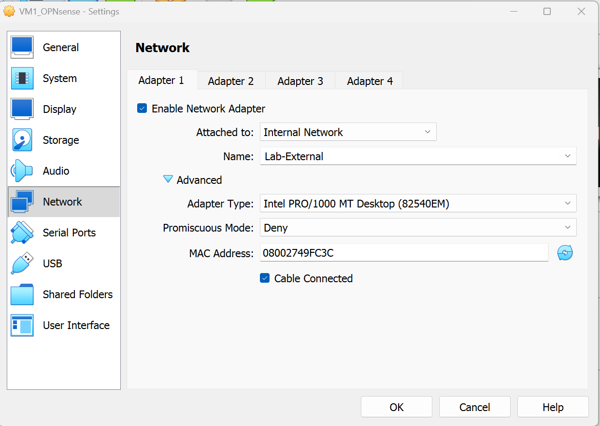

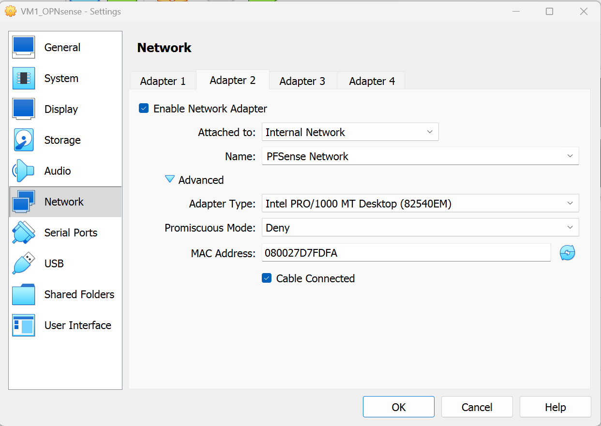

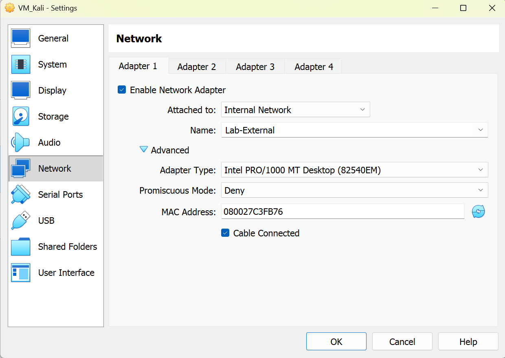

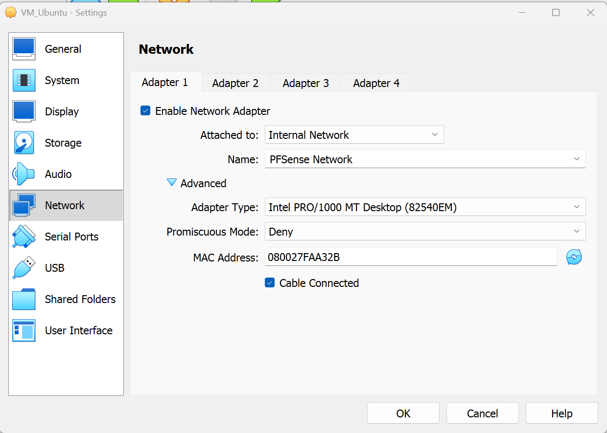

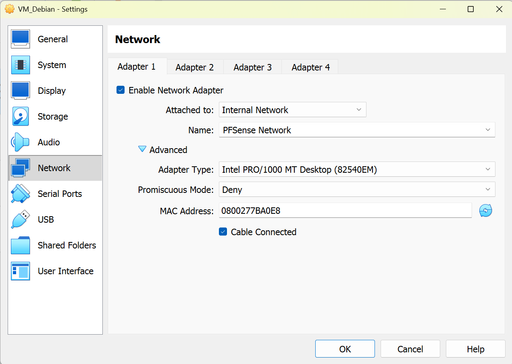

> **Troubleshooting — no connectivity:** Verify that each adapter is enabled, uses **Internal Network**, and has the correct case-sensitive network name. Do not enable NAT or Bridged Adapter to fix the final lab.

## 3. Install and configure OPNsense

### 3.1 Create and install the VM

1. Create `VM_OPNsense` in VirtualBox using **BSD / FreeBSD (64-bit)**.
2. Allocate **4 GB RAM**, **2 virtual CPUs**, and a **20 GB dynamically allocated virtual disk**. Leave EFI disabled.
3. Attach the extracted OPNsense installation ISO and start the VM.
4. At the installer environment, sign in with the installation account (`installer` / `opnsense`) and perform the installation to the virtual disk. The documented installation used **UFS**.
5. Set a unique root password, reboot, and remove the ISO from the virtual optical drive.
6. Assign interfaces at the console using **1) Assign interfaces**:
   - WAN: `em0`
   - LAN: `em1`
   - OPT1: none
7. Use **2) Set interface IP address** to configure LAN as `172.16.77.1/24`, with no upstream gateway, and enable DHCP for the LAN. Keep HTTPS management enabled.

**Initial management access:** The web interface is reached from a host temporarily connected to the LAN at `https://172.16.77.1`. A browser warning for the default self-signed certificate is expected. Confirm the destination before proceeding.

To administer OPNsense from Kali during setup:

1. Power off `VM_Kali` and temporarily enable **VirtualBox Adapter 2 → Internal Network → `PFSense Network`**. Keep Adapter 1 on `Lab-External`.
2. Start Kali. Identify its new LAN interface with `ip -br addr` (in the documented VM, this was `eth1`). If it does not receive a LAN DHCP address, verify that OPNsense LAN DHCP is enabled before continuing.
3. If Kali's existing route to the protected subnet still points through OPNsense WAN, add a temporary **host route to the management IP only** using the actual LAN interface:

   ```bash
   sudo ip route replace 172.16.77.1/32 dev eth1
   ```

4. Open `https://172.16.77.1` in Kali's browser to complete setup or inspect firewall logs.
5. **After administration, shut down Kali and disable Adapter 2.** Start Kali again and verify that only its `Lab-External` adapter remains active before testing segmentation.

**Important:** A temporary LAN-connected Kali adapter bypasses the intended WAN firewall boundary. Never leave it enabled during baseline or exercise isolation tests. The temporary `/32` host route is not part of Kali's permanent configuration.

### 3.2 Complete the initial web configuration

Configure the OPNsense setup wizard with the following recorded settings:

| Setting | Value |
| --- | --- |
| Hostname | `OPNsense` |
| Domain | `lab.local` |
| Language | English |
| Timezone | `America/New_York` |
| DNS servers | Blank |
| DNS override | Enabled during initial setup |
| Unbound DNS resolver | Enabled |
| DNSSEC | Unchecked |
| WAN | DHCP during initial installation only; replaced with static IPv4 below |
| LAN | `172.16.77.1/24`, DHCP enabled |
| Optimize for Multiwan | Unchecked |
| Automatic DHCP/DNS registration | Checked |
| Optimize for IPsec | Unchecked |

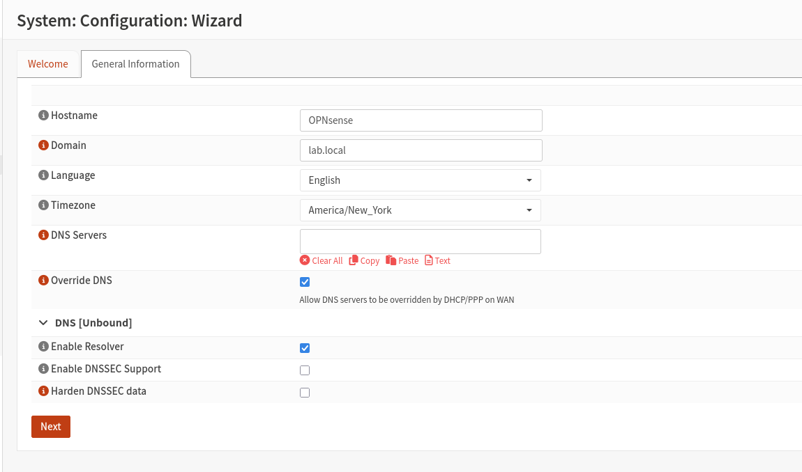

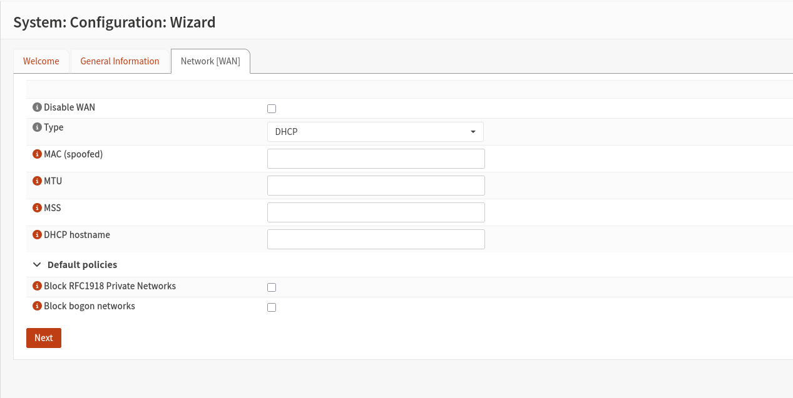

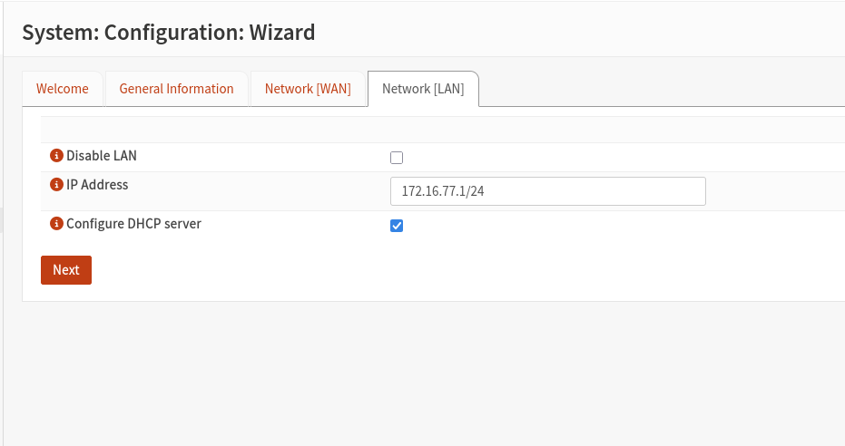

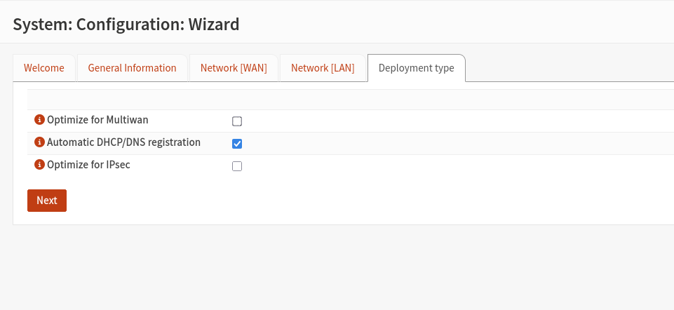

> **Note:** The initial WAN DHCP screenshot reflects a temporary installation configuration, **not the final isolated WAN**. The final WAN settings are shown in Section 3.4.

### 3.3 Update firmware

Apply available OPNsense firmware updates while an authorized, temporary internet connection is available, then return the firewall to the isolated network. The documented environment was updated to **26.7.9_3**.

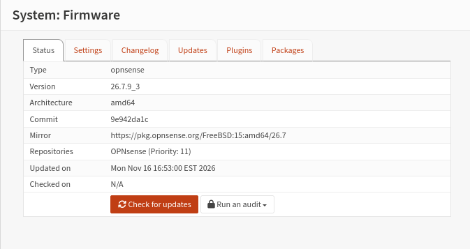

The following screenshot documents the **temporary NAT internet-connectivity test** performed before the final isolated WAN was configured. It is not evidence of internet access in the final environment.

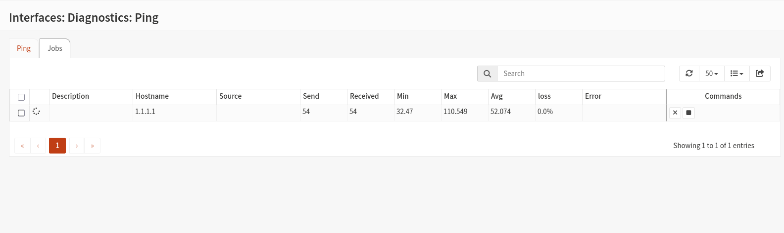

### 3.4 Configure the final isolated WAN

1. Navigate to **Interfaces → WAN**.
2. Enable the interface and select **Static IPv4**.
3. Set the address to `192.168.50.1/24`.
4. Set **Gateway: None**.
5. Uncheck **Block private networks** and **Block bogon networks** for this intentionally private, isolated test WAN.
6. Save and apply.


.png)
.png)

7. Power off `VM_OPNsense` and set VirtualBox **Adapter 1** to **Internal Network → `Lab-External`**. Leave Adapter 2 connected to `PFSense Network`.
8. Start OPNsense and confirm both interface addresses on the console.


Expected console addresses: **WAN `192.168.50.1/24`**, **LAN `172.16.77.1/24`**.

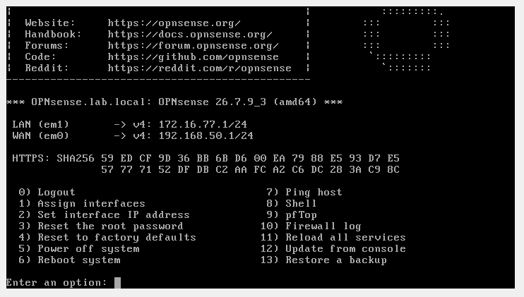

## 4. Configure LAN DHCP and reservations

The documented OPNsense configuration uses **Dnsmasq DNS & DHCP**; Kea DHCP is not enabled.

1. Open **Services → Dnsmasq DNS & DHCP** and enable Dnsmasq for the LAN.
2. Under **DHCP ranges**, configure:
   - Interface: LAN
   - Range: `172.16.77.100` to `172.16.77.199`
   - Lease time: `86400` seconds
   - Other fields: default unless required by the interface
3. Save and apply the configuration.

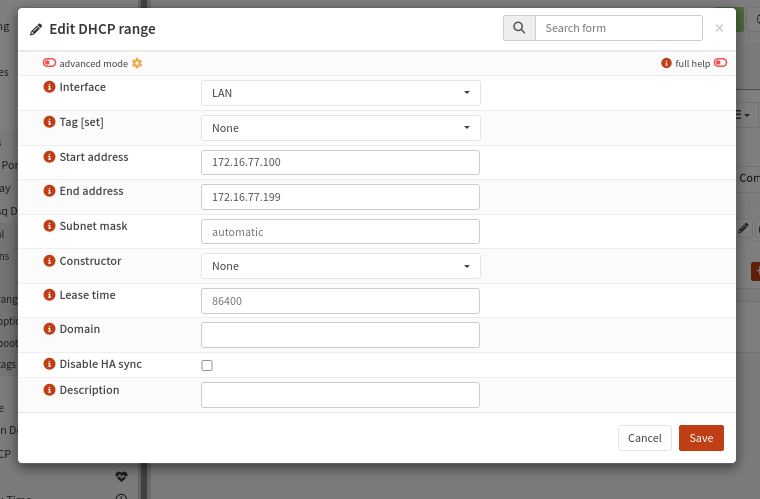

Under **Services → Dnsmasq DNS & DHCP → Hosts**, add the following **MAC-address-based reservations**:

| Host | Domain | Reserved IPv4 | MAC address |
| --- | --- | --- | --- |
| `ubuntu` | `lab.local` | `172.16.77.10` | `08:00:27:fa:a3:2b` |
| `debian` | `lab.local` | `172.16.77.11` | `08:00:27:7b:a0:e8` |

Leave Client identifier blank and the other reservation options at their documented defaults. These MAC addresses match the recorded VMs; **use your actual VM MAC addresses** if VirtualBox generates different ones.

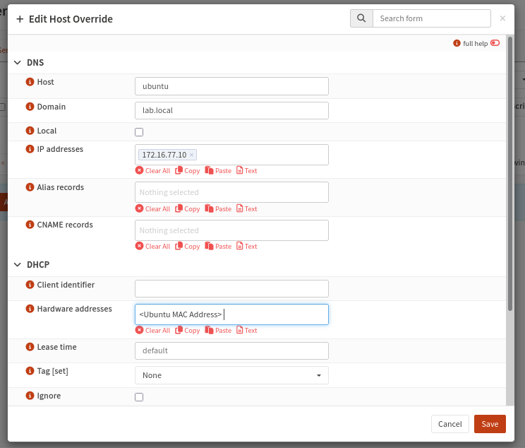

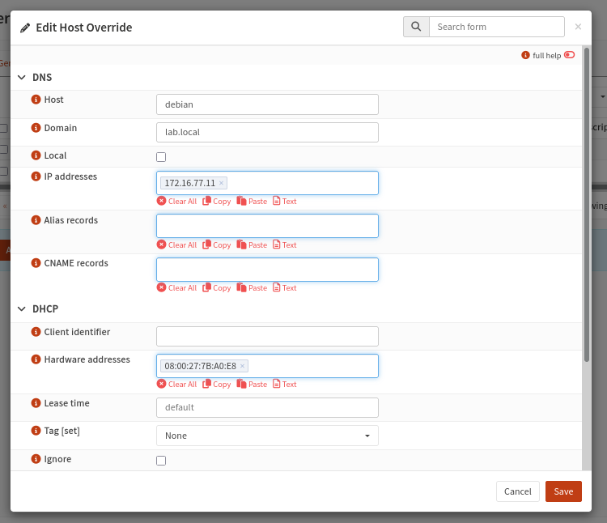

> **Troubleshooting — reservation not applied:** Verify the IP and MAC under **Hosts**, save/apply, restart Dnsmasq under **System → Diagnostics → Services**, then renew DHCP or reboot the guest. Check its address using `ip -4 addr show enp0s3`.

## 5. Configure Ubuntu

1. Start `VM_Ubuntu` with its only enabled adapter on `PFSense Network`.
2. Verify the OS and required tools installed during [Initial VM Preparation](#initial-vm-preparation):

   ```bash
   cat /etc/os-release
   for tool in curl wget nmap tcpdump dig nc ssh; do
       command -v "$tool" || echo "[MISSING] $tool"
   done
   ```

   Enable and start the documented Apache (TCP 80) and SSH (TCP 22) services, then confirm both are active:

   ```bash
   sudo systemctl enable --now apache2 ssh
   systemctl is-active apache2 ssh
   ```

   Expected: both services report `active`. If packages are missing, complete the Ubuntu installation commands in Section 1 before proceeding. The VM should now be connected only to **Internal Network → `PFSense Network`**.


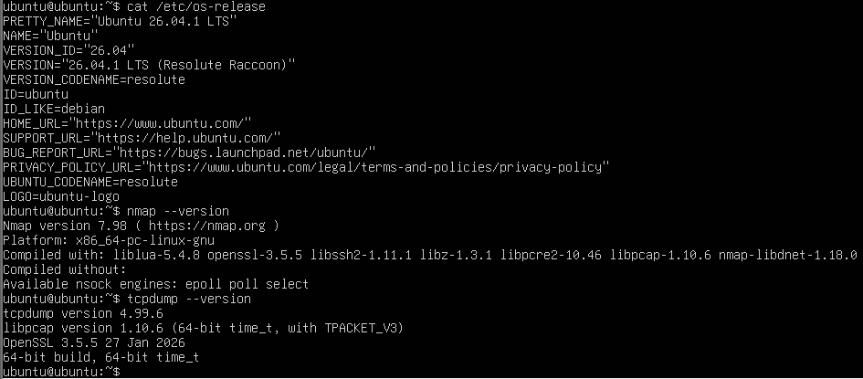
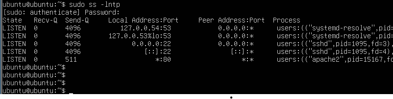
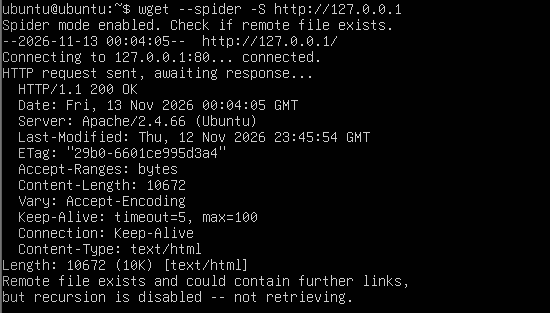

3. Configure DHCP and a **persistent route** to the external test subnet in the appropriate Netplan YAML file:

```yaml
network:
  ethernets:
    enp0s3:
      dhcp4: true
      dhcp-identifier: mac
      dhcp6: true
      routes:
        - to: 192.168.50.0/24
          via: 172.16.77.1
  version: 2
```

Apply the configuration:

```bash
sudo netplan try
sudo netplan apply
```

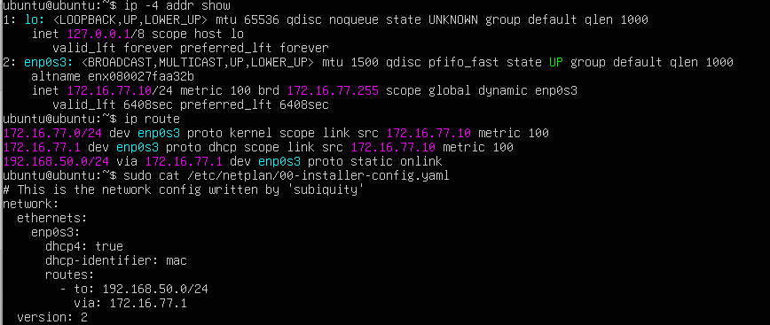

4. Verify the DHCP reservation, route, and LAN reachability:

```bash
ip -4 addr show enp0s3
ip route
ping -c 4 172.16.77.1
```

Expected: `172.16.77.10/24`, a route to `192.168.50.0/24` via `172.16.77.1`, and successful replies from OPNsense LAN.


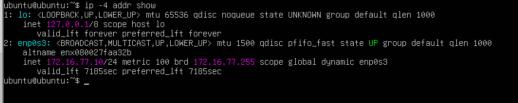
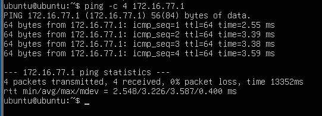

## 6. Configure Debian

1. Start `VM_Debian` with its only enabled adapter on `PFSense Network`.
2. Verify the operating system and installed tools:

   ```bash
   cat /etc/os-release
   for tool in nmap tcpdump curl wget nc ssh; do
       command -v "$tool" >/dev/null 2>&1 && echo "[OK] $tool" || echo "[MISSING] $tool"
   done
   ```

   All six tools should report `[OK]`. If any are missing, revisit the package installation instructions in [Section 1 — Prerequisites](#1-prerequisites).

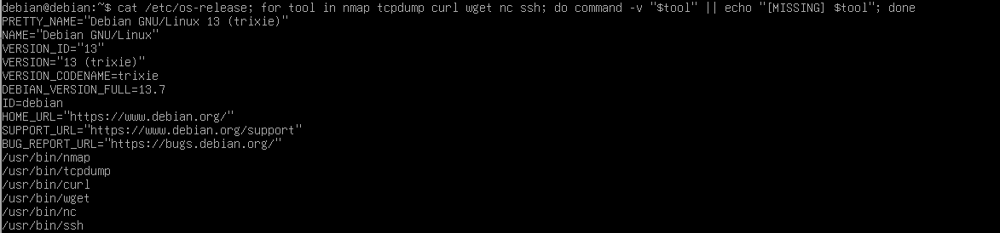
3. Configure DHCP and a persistent route using `/etc/network/interfaces` (the documented Debian host uses **ifupdown**):

```ini
allow-hotplug enp0s3
iface enp0s3 inet dhcp
    post-up ip route replace 192.168.50.0/24 via 172.16.77.1 dev enp0s3
    pre-down ip route del 192.168.50.0/24 via 172.16.77.1 dev enp0s3 || true
```

Edit the existing interface stanza rather than duplicating it. Apply the changes using an interface restart or a VM reboot.

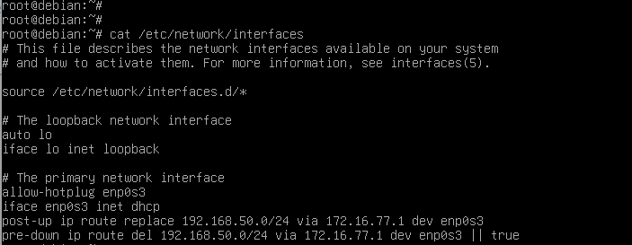

4. Verify:

```bash
ip -4 addr show enp0s3
ip route
ping -c 4 172.16.77.1
```

Expected: `172.16.77.11/24`, a route to `192.168.50.0/24` via `172.16.77.1`, and successful replies from OPNsense LAN.


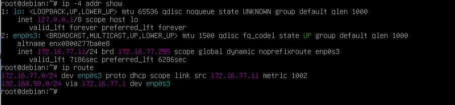
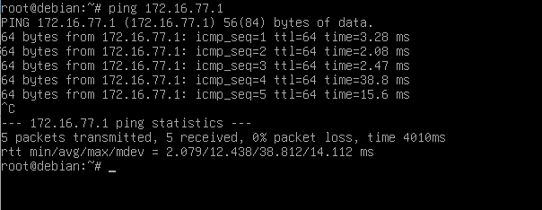

## 7. Configure Kali's persistent external address

1. Start `VM_Kali` with **Adapter 1 only**, connected to `Lab-External`. Confirm the active NetworkManager profile and interface:

```bash
ip -br addr
nmcli -f NAME,DEVICE connection show --active
```

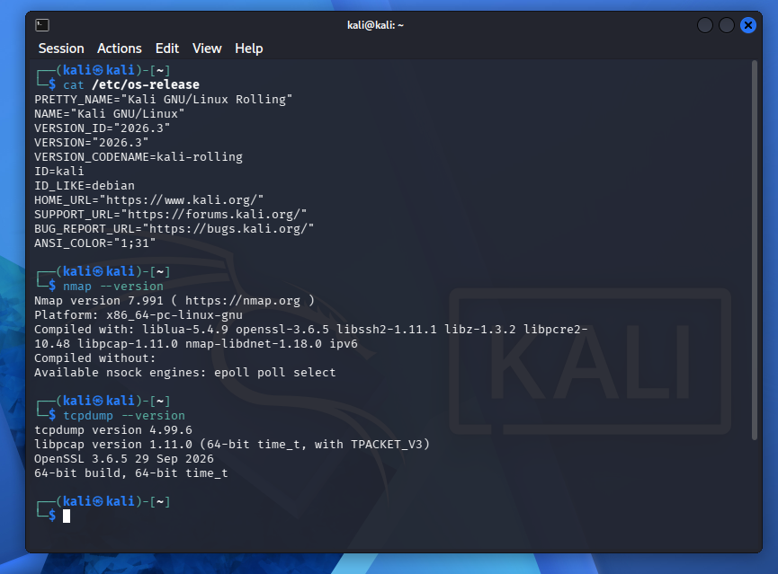

2. The documented profile is named **`Wired connection 1`** and uses interface `eth0`. Configure a static address and persistent route:

```bash
sudo nmcli connection modify "Wired connection 1" \
  ipv4.method manual \
  ipv4.addresses 192.168.50.10/24 \
  ipv4.gateway "" \
  ipv4.dns "" \
  ipv4.never-default yes \
  ipv4.routes "172.16.77.0/24 192.168.50.1"
```

`ipv4.never-default yes` prevents Kali from treating this isolated interface as an internet gateway. The `ipv4.routes` setting tells Kali to send traffic for the protected subnet through OPNsense WAN.

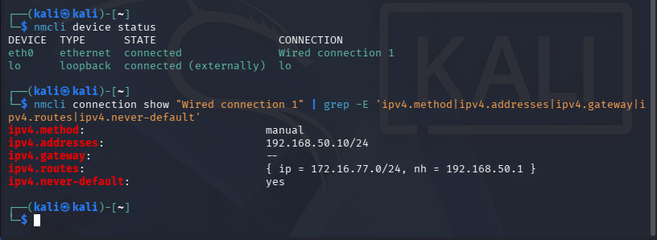

3. Reactivate the connection and verify:

```bash
sudo nmcli connection up "Wired connection 1"
ip -4 addr show eth0
ip route
```

Expected: `192.168.50.10/24` on `eth0`, **no default route**, and `172.16.77.0/24 via 192.168.50.1`.

4. Reboot Kali and repeat the checks to confirm persistence.

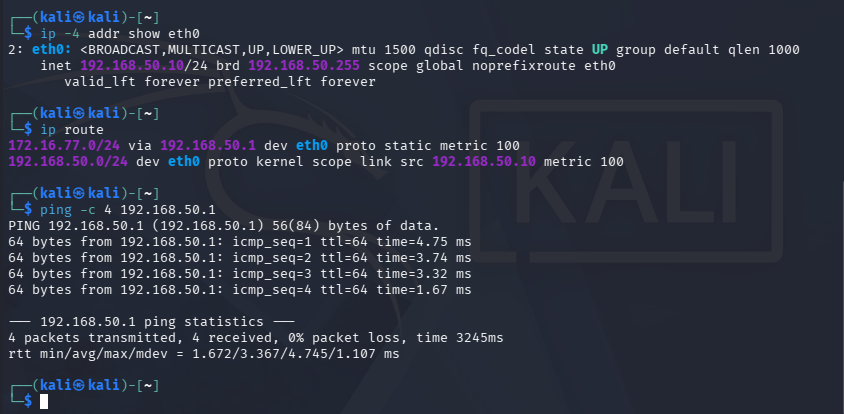


> **Troubleshooting — `Network is unreachable`:** Verify the route to `172.16.77.0/24` exists before treating a failed ping as a firewall block.

## 8. Configure a narrow OPNsense WAN ICMP rule

OPNsense's default WAN policy blocks unsolicited inbound traffic. Permit only Kali's ICMP echo requests **to the firewall WAN address**, not to the protected LAN.

1. In OPNsense, open **Firewall → Rules → WAN** and add a rule.
2. Configure:
   - Enabled: checked
   - Description: `Allow Kali ICMP to OPNsense WAN`
   - Interface: WAN
   - Action: Pass
   - Direction: In
   - IP version: IPv4
   - Protocol: ICMP
   - ICMP type: Echo request (if selectable)
   - Source: `192.168.50.10/32`
   - Destination: WAN address
   - Log: checked
   - State type: Keep state
3. Save and apply the rule.

.png)

.png)

> **Note:** Include the `/32` subnet mask when entering Kali's source IP (`192.168.50.10/32`) in the OPNsense firewall rule.

This exception allows Kali to ping the **firewall**, not Ubuntu or Debian.

## 9. Validate connectivity and firewall enforcement

With Kali connected **only** to `Lab-External`, run:

```bash
# Expected: 4 replies from OPNsense WAN
ping -c 4 192.168.50.1

# Expected: no replies from protected hosts
ping -c 4 172.16.77.10
ping -c 4 172.16.77.11
```

The completed baseline verified successful Kali-to-OPNsense WAN ICMP and failed Kali-to-Ubuntu/Debian ICMP.

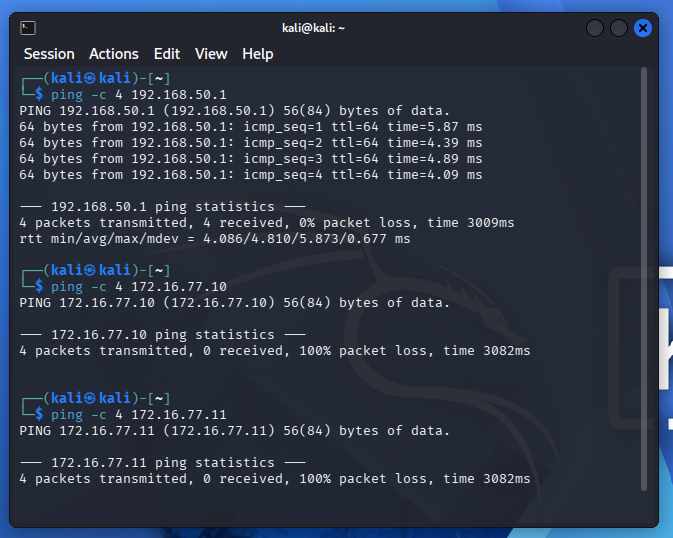

**Verify the firewall, not just the ping timeout.** In OPNsense, open **Firewall → Log Files → Live View** and identify the blocked traffic:

| Field | Expected value |
| --- | --- |
| Interface | WAN, inbound |
| Action | Block |
| Protocol | ICMP |
| Source | `192.168.50.10` |
| Destination | `172.16.77.10` |
| Rule | Default deny / state violation rule |

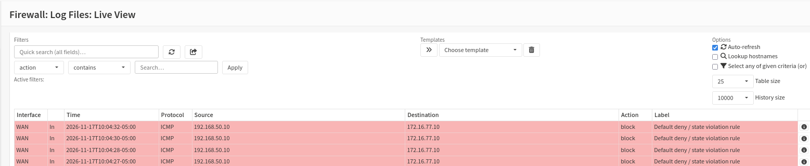

> **Management access:** OPNsense's web interface is on its LAN address (`https://172.16.77.1`). A temporary Kali LAN adapter was used during configuration and log review, then disabled again. **Do not leave this adapter enabled** during segmentation tests, because it creates a path around the firewall's WAN rules.

## 10. Baseline completion checklist

- [ ] All four VMs start successfully.
- [ ] Every active adapter uses VirtualBox **Internal Network** mode.
- [ ] OPNsense WAN is `192.168.50.1/24` on `Lab-External`.
- [ ] OPNsense LAN is `172.16.77.1/24` on `PFSense Network`.
- [ ] No final WAN gateway, NAT adapter, or bridged adapter is present.
- [ ] Dnsmasq serves `172.16.77.100–172.16.77.199`.
- [ ] Ubuntu receives reserved address `172.16.77.10`.
- [ ] Debian receives reserved address `172.16.77.11`.
- [ ] Ubuntu and Debian can reach OPNsense LAN.
- [ ] Kali has static `192.168.50.10/24` and a persistent route to `172.16.77.0/24` through OPNsense.
- [ ] Kali has **no second LAN adapter** in the final topology.
- [ ] Kali can ping OPNsense WAN using the restricted ICMP rule.
- [ ] Kali cannot ping Ubuntu or Debian under the default WAN deny policy.
- [ ] OPNsense logs confirm blocked Kali-to-Ubuntu ICMP.

## 11. Before starting the security exercises

Take a VirtualBox snapshot of each VM before introducing exercise-specific rules, services, or test traffic. Keep the environment isolated, and do not publish credentials, private keys, or sensitive firewall configuration exports.

The lab is now ready for **Exercise 1 — Stateful Firewall & Network Segmentation**.
