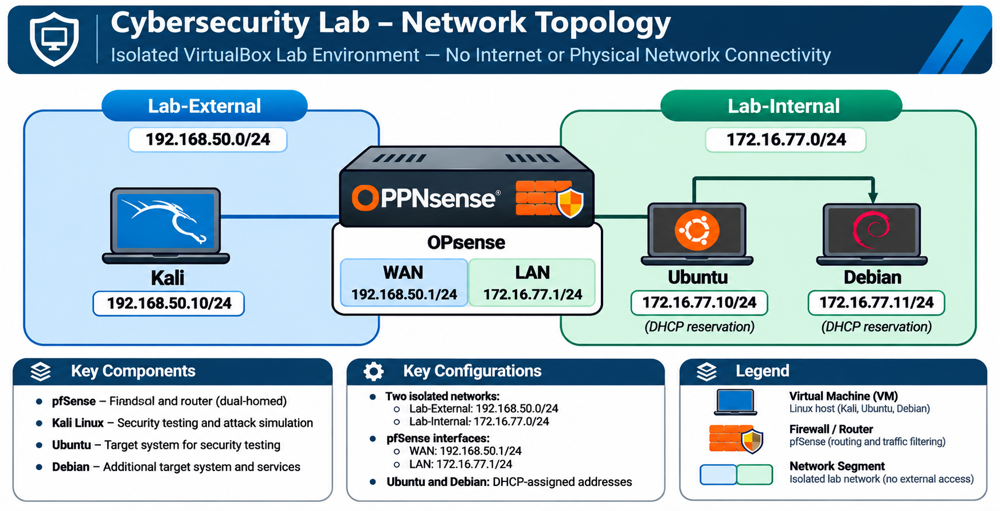

# Cyber Defense Training Environment

**Project Status:** Core environment configured. Exercise enhancements in progress.

**[Lab Environment Setup](Lab%20Environment%20Setup.md)**

## Overview

10 hands-on cybersecurity labs designed to provide aspiring and entry-level professionals with an accessible, reproducible environment for developing practical security skills. Built in VirtualBox using OPNsense, Kali Linux, Ubuntu, and Debian. The project features structured exercises covering network security engineering, traffic analysis, threat detection, system hardening, and incident investigation.

## Opening Notes

This environment is simple by design. It is intended for you to develop an understanding of fundamental IT/Networking/Cybersecurity principles, and then put them to practice through hands-on exercises.

Each exercise comes with a 'prerequisite knowledge' markdown file that outlines conceptual topics that will help you to understand the context of each exercise. I highly encourage reading through them before jumping into the walk-throughs if you're still developing your foundational knowldge. These walk-throughs are not simply a list of steps to follow - throughout them, you will see command/flag/paremeter explanations, output interpretations, and other relevant considerations. Over time, you will see the terminal turn from gibberish to comprehensible text. 

Preconfigured .ova files are available upon request. However, I would argue that troubleshooting the configuration is JUST AS VALUABLE as completing the tasks, especially if you are new to IT in general. 

Configuring this environment and completing these labs will provide you with valuable experience in virtualization, networking, systems administration, command line/OS familiarity, and most importantly - troubleshooting. Working through the configuration and exercise tasks is a great illustration of Occam's razor (the simplest explanation is often the correct one). Many times you'll find that the first thing to check when troubleshooting is spelling or syntax. This holds true to a certain extent in the workplace as well. Your convoluted theory as to why 2 systems aren't talking may be as simple as an unseated connection somewhere along the path. 

Finally, I encourage you to build on and personalize this environment after configuring it. Reconfigure, rework, supplement, augment, or completely blow it up altogether. Then document it on your own GitHub repo. 

## Network Topology

*The entire lab is isolated from internet and physical network connectivity. **Lab-External** and **Lab-Internal** are separate network segments connected through OPNsense; they are not independent internet-connected networks.*

| Component | Purpose | Network / Address |
| --- | --- | --- |
| Kali Linux | Simulated external testing and traffic generation | Lab-External — `192.168.50.10/24` (static) |
| OPNsense 26.7 | Stateful firewall and router | WAN `192.168.50.1/24` · LAN `172.16.77.1/24` |
| Ubuntu | Protected application and test host | Lab-Internal — `172.16.77.10/24` (DHCP reservation) |
| Debian | Protected service and logging host | Lab-Internal — `172.16.77.11/24` (DHCP reservation) |

The logical segment names in the diagram are **Lab-External** and **Lab-Internal**. In VirtualBox, their actual *Internal Network* names are `Lab-External` and `PFSense Network`, respectively. Ubuntu and Debian receive their addresses through DHCP reservations configured in OPNsense.

## Verified Baseline

- Deployed four VMs on two VirtualBox Internal Network segments, with no NAT or bridged adapter in the final configuration.
- Configured OPNsense WAN/LAN addressing and LAN DHCP with reservations for Ubuntu and Debian.
- Configured Kali's static address and a persistent NetworkManager route to the protected subnet through OPNsense.
- Verified Kali can reach OPNsense WAN through a narrowly scoped ICMP rule.
- Confirmed OPNsense's default WAN deny rule blocks Kali-to-Ubuntu ICMP and records the denied traffic in firewall logs.
- Verified protected hosts can reach OPNsense LAN.

## Exercises

| Exercise |
|---|
| [01 — Stateful Firewall & Network Segmentation](exercises/01-stateful-firewall-segmentation/README.md) |
| [02 — Exposed Service Hardening](exercises/02-exposed-service-hardening/README.md) |
| [03 — Packet Capture & Protocol Analysis](exercises/03-packet-capture-protocol-analysis/README.md) |
| [04 — Network Reconnaissance & Firewall Testing](exercises/04-network-reconnaissance-firewall-testing/README.md) |
| [05 — Host-Based Firewall Defense](exercises/05-host-based-firewall-defense/README.md) |
| [06 — SSH Brute-Force Detection & Response](exercises/06-ssh-detection/README.md) |
| [07 — Suricata IDS & Detection Engineering](exercises/07-suricata-ids/README.md) |
| [08 — Centralized Syslog & Event Correlation](exercises/08-centralized-syslog/README.md) |
| [09 — OpenVPN & Least-Privilege Access](exercises/09-openvpn/README.md) |
| [10 — Simulated Security Incident Investigation](exercises/10-incident-investigation/README.md) |

## Getting Started

See [Lab Environment Setup](Lab%20Environment%20Setup.md) for VM configuration, VirtualBox networking, OPNsense settings, and connectivity validation. The original VM images are not distributed in this repository; use appropriately licensed installation media or build equivalent VMs following the documented architecture.

## Security Considerations

**For isolated educational use only.** This lab uses OPNsense and Linux virtual machines in an isolated VirtualBox environment. Do not attach the VMs to a production, home, or public network, and do not expose management interfaces to the internet. Use unique credentials, keep software updated, and never publish passwords, private keys, or sensitive configuration exports. Isolation reduces exposure but does not eliminate all risk.
