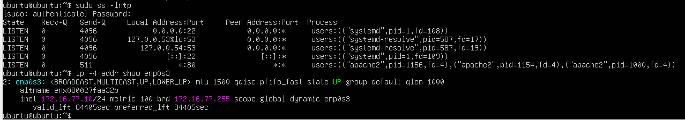
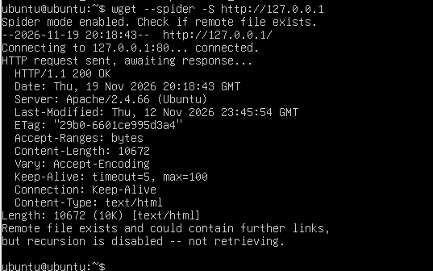
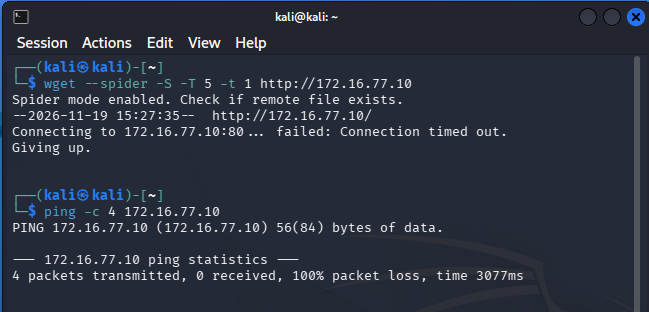
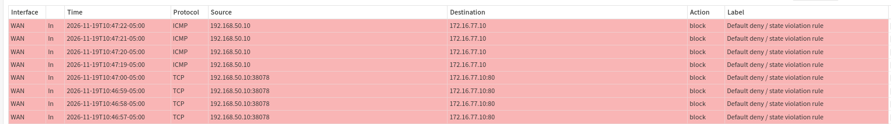
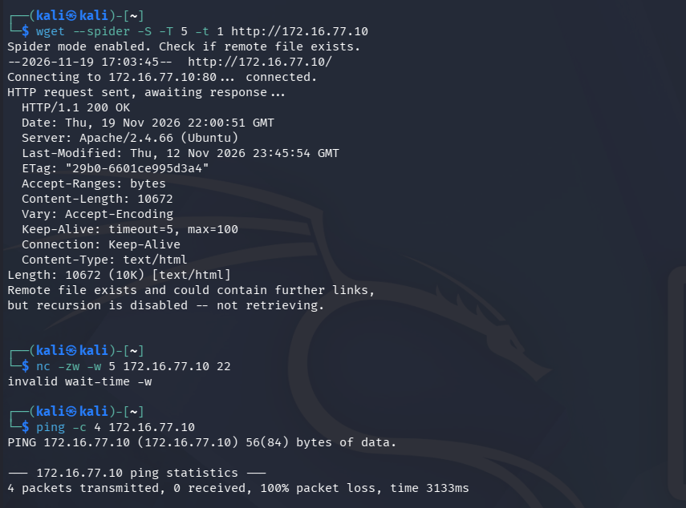
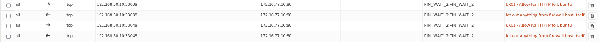
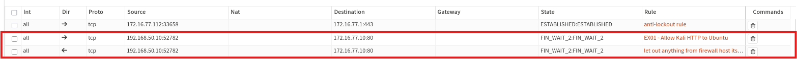
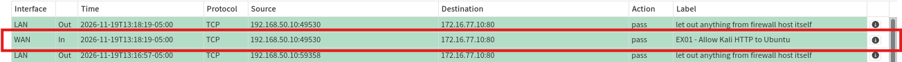
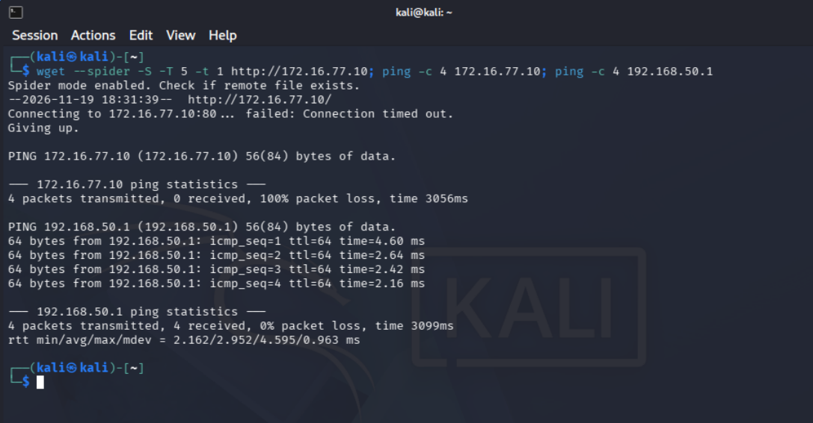
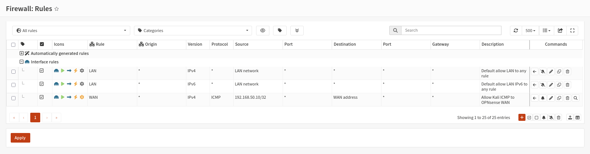

# Exercise 1 — Stateful Firewall & Network Segmentation

## Overview

This walkthrough documents a verified exercise using an isolated VirtualBox lab. You will identify an internal web service, observe default-deny behavior, configure a narrowly scoped OPNsense WAN rule, validate stateful filtering, review firewall logs, and restore the original policy.

**Environment:** OPNsense 26.7, Kali Linux 2026.3, Ubuntu Server 26.04.1 LTS, and Debian 13.7. All VMs use VirtualBox Internal Networks; the final lab has no NAT or bridged adapter.

| Component | Address | Role |
|---|---|---|
| Kali (`Lab-External`) | `192.168.50.10/24` | External testing host |
| OPNsense WAN (`em0`) | `192.168.50.1/24` | External firewall interface |
| OPNsense LAN (`em1`) | `172.16.77.1/24` | Internal firewall interface |
| Ubuntu (`Lab-Internal`) | `172.16.77.10/24` | Protected Apache and SSH host |
| Debian (`Lab-Internal`) | `172.16.77.11/24` | Additional protected host |

> **Before starting:** Complete [Lab Environment Setup](../../Lab%20Environment%20Setup.md), verify the baseline, and take a snapshot of OPNsense before changing rules. The VirtualBox Internal Network named `PFSense Network` is the actual network behind the logical `Lab-Internal` segment.

> **Management access:** Kali normally has only Adapter 1 connected to `Lab-External`. To administer OPNsense, temporarily connect Kali Adapter 2 to the VirtualBox Internal Network `PFSense Network`, then run `sudo ip route replace 172.16.77.1/32 dev eth1` (verify that the second interface is `eth1`). Open `https://172.16.77.1`. **Disable Adapter 2 before segmentation tests.** When using temporary management access to inspect states or logs, verify `ip route get 172.16.77.10` still points through `192.168.50.1 dev eth0`; otherwise the test may bypass the WAN firewall.

## Task 1 — Identify an Internal Service

**Objective:** Confirm that Ubuntu has the expected network address and that Apache and SSH are listening.

### Step 1.1 — Inspect listening services and IP address

On Ubuntu, run:

```bash
sudo ss -lntp
ip -4 addr show enp0s3
```

| Command or flag | Meaning |
|---|---|
| `sudo` | Run with administrative privileges |
| `ss` | Display socket information |
| `-l` | Show listening sockets |
| `-n` | Show numeric addresses and ports |
| `-t` | Show TCP sockets |
| `-p` | Show owning processes |
| `ip -4 addr show enp0s3` | Show IPv4 addresses assigned to Ubuntu's `enp0s3` interface |

**Verify:** Apache is listening on TCP 80, SSH on TCP 22, and Ubuntu has `172.16.77.10/24`. If the IPv4 address is missing, ensure OPNsense is running and providing DHCP before continuing.



### Step 1.2 — Verify Apache locally

On Ubuntu, run:

```bash
wget --spider -S http://127.0.0.1
```

| Option | Meaning |
|---|---|
| `wget` | HTTP download and request utility |
| `--spider` | Check the URL without downloading its body |
| `-S` | Display HTTP response headers |
| `127.0.0.1` | The local loopback address |

**Verify:** Apache returns an HTTP success response (observed: `HTTP/1.1 200 OK`). This verifies local service operation, not external accessibility.



## Task 2 — Establish Baseline Connectivity

**Objective:** Demonstrate that Kali cannot reach Ubuntu's HTTP service or ping Ubuntu under the original WAN policy.

### Step 2.1 — Test traffic from Kali

Ensure Kali's temporary Adapter 2 is **disabled**. On Kali, run:

```bash
wget --spider -S -T 5 -t 1 http://172.16.77.10
ping -c 4 172.16.77.10
```

| Option | Meaning |
|---|---|
| `-T 5` (`wget`) | Use a five-second network timeout |
| `-t 1` (`wget`) | Attempt the request once |
| `ping` | Send ICMP echo requests to test reachability |
| `-c 4` (`ping`) | Send four echo requests |

**Observed:** HTTP timed out and ICMP received no replies (100% packet loss).



### Step 2.2 — Correlate the denied traffic with OPNsense logs

Temporarily enable Kali's management adapter as described above. In OPNsense, open **Firewall → Log Files → Live View** and locate entries with source `192.168.50.10` and destination `172.16.77.10`.

**Observed:** WAN inbound TCP traffic to destination port 80 and ICMP traffic were blocked under `Default deny / state violation rule`.

> **Learning note — Source ports:** TCP and UDP clients typically use dynamically allocated (*ephemeral*) source ports, often selected randomly or pseudorandomly by the operating system; destination ports identify the requested service, such as HTTP on TCP 80.



## Task 3 — Configure a Least-Privilege Firewall Rule

**Objective:** Allow only HTTP traffic from Kali to Ubuntu while retaining the default-deny policy for other services.

### Step 3.1 — Preserve a rollback point

Create an OPNsense VirtualBox snapshot named `Exercise-01-Pre-Firewall-Change` before modifying the rule set.

### Step 3.2 — Add the WAN HTTP exception

In OPNsense, open **Firewall → Rules → WAN** and add a rule with these settings:

| Field | Value |
|---|---|
| Enabled | Checked |
| Categories | Nothing selected |
| Description | `EX01 - Allow Kali HTTP to Ubuntu` |
| Interface (rule) | WAN |
| Interface (origin) | any |
| Quick | Checked |
| Action | Pass |
| Direction | In |
| Version | IPv4 |
| Protocol | TCP |
| Invert Source | Unchecked |
| Source | `192.168.50.10/32` |
| Source Port | any |
| Invert Destination | Unchecked |
| Destination | `172.16.77.10/32` |
| Destination Port | `80` (HTTP) |
| Log | **Checked** |
| State type | keep state |
| Gateway | None |
| Audit | Leave defaults |

Save the rule and **click Apply Changes**. Ensure the rule is enabled and placed above any broader conflicting block rule. Leave the existing Kali-to-OPNsense WAN ICMP exception unchanged.

**Why `/32`?** It restricts the rule to one IPv4 host at each end. **Why `keep state`?** It lets the firewall track the allowed TCP connection and recognize its return traffic.

.png)
.png)

## Task 4 — Validate Authorized and Unauthorized Traffic

**Objective:** Verify that only HTTP is newly accessible from Kali to Ubuntu.

### Step 4.1 — Confirm external-only testing and routing

Disable Kali's temporary Adapter 2, reboot Kali if needed, and run:

```bash
ip -br addr
ip route
```

**Verify:** `eth0` has `192.168.50.10/24`, the route to `172.16.77.0/24` uses `192.168.50.1`, and no internal LAN adapter is active.

### Step 4.2 — Test HTTP, SSH, and ICMP

On Kali, run:

```bash
wget --spider -S -T 5 -t 1 http://172.16.77.10
nc -zv -w 5 172.16.77.10 22
ping -c 4 172.16.77.10
```

| Command or option | Meaning |
|---|---|
| `nc` | Netcat, a network connection-testing utility |
| `-z` | Check connectivity without sending application data |
| `-v` | Show verbose output |
| `-w 5` | Wait up to five seconds |
| `22` | Destination TCP port for SSH |

| Test | Observed result |
|---|---|
| HTTP to Ubuntu TCP 80 | Allowed; HTTP success response |
| SSH to Ubuntu TCP 22 | Timed out |
| ICMP to Ubuntu | 100% packet loss |



## Task 5 — Inspect Stateful Connections

**Objective:** Observe OPNsense tracking permitted HTTP connections.

### Step 5.1 — Confirm the test route and generate traffic

With temporary management access enabled, verify that Kali's route to Ubuntu still crosses OPNsense WAN:

```bash
ip route get 172.16.77.10
```

**Observed:** The route used `via 192.168.50.1 dev eth0 src 192.168.50.10`.

On Kali, generate repeated HTTP requests so a state is easier to observe:

```bash
while true; do wget --spider -q -T 5 -t 1 http://172.16.77.10; sleep 1; done
```

| Command or option | Meaning |
|---|---|
| `while true; do ...; done` | Repeat commands until interrupted |
| `-q` (`wget`) | Suppress normal output |
| `sleep 1` | Wait one second between requests |

Stop the loop with **Ctrl+C** after capturing evidence. These are repeated short connections, not one continuously open HTTP connection.

### Step 5.2 — Inspect the state table

In OPNsense, navigate to **Firewall → Diagnostics → States**, then filter for `192.168.50.10` and look for TCP entries destined for `172.16.77.10:80`.

**Observed:** Connections were associated with `EX01 - Allow Kali HTTP to Ubuntu`; the displayed state included `FIN_WAIT_2:FIN_WAIT_2`, indicating TCP connections in their closing phase. Paired directional entries were visible.



> **Learning note — Stateful vs. stateless firewalls:** A **stateful** firewall tracks connections and can permit matching return packets based on an established state. A **stateless** firewall evaluates each packet against its rules without maintaining a connection state. The entries below illustrate OPNsense's tracking of an HTTP connection; `FIN_WAIT_2` indicates a closing TCP connection, not a blocked connection.



## Task 6 — Review Firewall Logs

**Objective:** Match the authorized HTTP connection to the rule permitting it.

### Step 6.1 — Find logged WAN permit events

In OPNsense, open **Firewall → Log Files → Live View** and filter for source `192.168.50.10`. Locate WAN inbound TCP entries to `172.16.77.10:80` with action **pass** and label `EX01 - Allow Kali HTTP to Ubuntu`.

If no entries appear, confirm that **Log** is checked in the rule editor and, critically, that you clicked **Save** **and** **Apply Changes**. Generate a fresh HTTP request after applying the rule:

```bash
wget --spider -S -T 5 -t 1 http://172.16.77.10
```

**Observed troubleshooting outcome:** The initial missing WAN permit logs occurred because the logging setting had been saved but **not applied**. Applying the change resolved the issue. Deleting connection states was **not** necessary to resolve this incident.

**Observed:** A WAN inbound TCP pass entry was recorded for Kali to Ubuntu TCP 80 under the exercise HTTP allow rule.



### Step 6.2 — Compare permitted and denied traffic

Compare the permitted WAN HTTP entry above with the baseline blocked TCP 80 and ICMP entries from Task 2. The difference is the explicit, narrowly scoped WAN allow rule.

> **Learning note — Logging and state:** Firewall rules commonly log connection-initiating packets rather than every packet in a tracked connection. When testing changes to logging or filtering, generate a new connection and check that the configuration has actually been applied. Existing states may also affect subsequent packet evaluation, but they were not the cause of this exercise's missing log entries.

## Task 7 — Restore the Baseline

**Objective:** Remove the temporary HTTP exception and verify the original segmentation policy is restored.

### Step 7.1 — Remove the exercise rule

In **Firewall → Rules → WAN**, delete `EX01 - Allow Kali HTTP to Ubuntu`, then click **Apply Changes**. Preserve the existing rule allowing Kali to ping the OPNsense WAN address.

### Step 7.2 — Inspect remaining HTTP states

In **Firewall → Diagnostics → States**, filter for Kali (`192.168.50.10`). If exercise-specific TCP states to `172.16.77.10:80` remain, clear **only** those states so an existing connection does not affect the restored-policy test. Do not clear unrelated management states.

### Step 7.3 — Verify the restored behavior

Disable Kali's temporary Adapter 2. On Kali, run:

```bash
wget --spider -S -T 5 -t 1 http://172.16.77.10; ping -c 4 172.16.77.10; ping -c 4 192.168.50.1
```

**Command note:** `;` runs commands sequentially even if an earlier command fails.

| Test | Observed result |
|---|---|
| Kali → Ubuntu HTTP | Connection timed out |
| Kali → Ubuntu ICMP | 4 transmitted, 0 received (100% loss) |
| Kali → OPNsense WAN ICMP | 4 transmitted, 4 received (0% loss) |



### Step 7.4 — Verify final WAN rules

Temporarily enable Kali's management adapter to access OPNsense. In **Firewall → Rules**, confirm that the HTTP exception is absent and the original WAN ICMP exception is enabled. If the interface displays pending changes, click **Apply** before finishing.



Finally, shut down Kali and **disable Adapter 2** so it remains an external-only testing host.

## Completion Checklist

- [ ] Ubuntu services and IP address verified
- [ ] Baseline Kali-to-Ubuntu HTTP and ICMP denied
- [ ] Default-deny WAN log entries observed
- [ ] Narrow Kali-to-Ubuntu TCP 80 rule configured and tested
- [ ] SSH and ICMP remained blocked after HTTP was allowed
- [ ] HTTP connection states observed
- [ ] WAN HTTP permit log captured after applying logging change
- [ ] Temporary HTTP rule removed and original connectivity verified
- [ ] Final Kali management adapter disabled (confirm after final screenshot)

**End state:** The original WAN ICMP exception remains in place; Kali-to-Ubuntu HTTP and ICMP are blocked, and no temporary HTTP allow rule remains.
