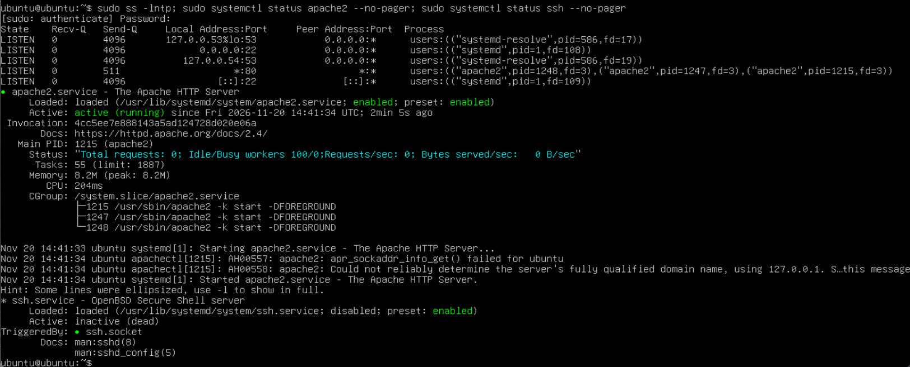
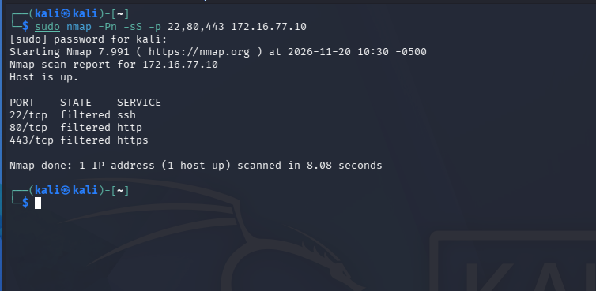
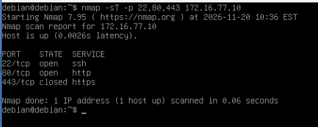
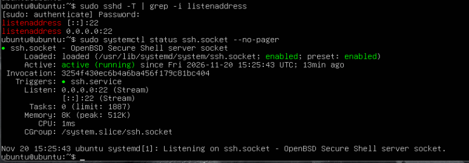
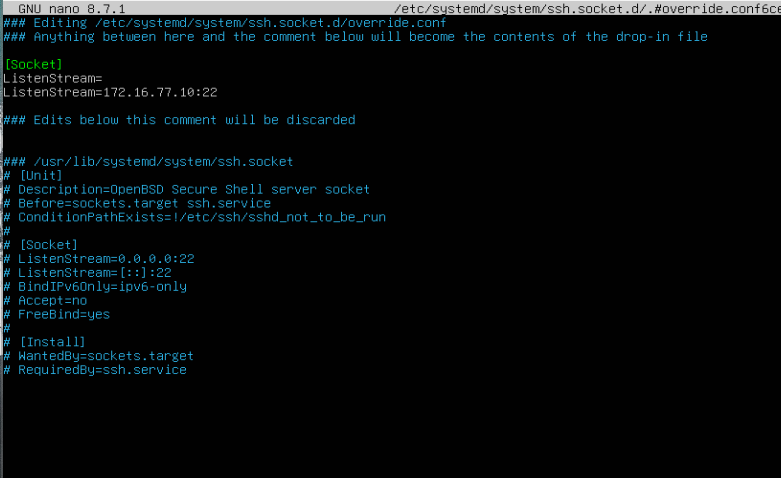
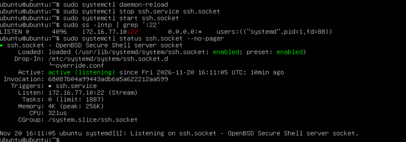
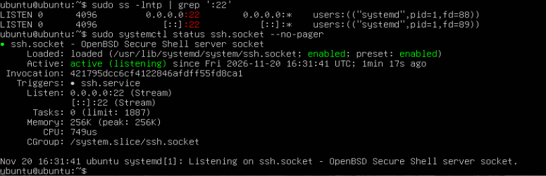

# Exercise 2 — Exposed Service Hardening

## Overview

This walkthrough documents service discovery, internal and external port scanning, a reversible SSH listening-address change, validation, and restoration in the isolated VirtualBox lab.

**Environment:** OPNsense 26.7, Kali Linux 2026.3, Ubuntu Server 26.04.1 LTS, Debian 13.7, and VirtualBox Internal Networks.

| Component | Address | Role |
|---|---|---|
| Kali (`Lab-External`) | `192.168.50.10/24` | External scanning host |
| OPNsense WAN | `192.168.50.1/24` | External firewall interface |
| OPNsense LAN | `172.16.77.1/24` | Internal firewall interface |
| Ubuntu (`Lab-Internal`) | `172.16.77.10/24` | Apache and SSH target |
| Debian (`Lab-Internal`) | `172.16.77.11/24` | Internal scanning host |

**Before starting:** Complete [Lab Environment Setup](../../Lab%20Environment%20Setup.md) and restore Exercise 1's default WAN policy. Keep all VM adapters on VirtualBox Internal Networks. Kali's temporary LAN management adapter must be disabled during external scans. Consider a VM snapshot before changing SSH settings.

## Task 1 — Identify Listening Services

**Objective:** Establish Ubuntu's service baseline.

On Ubuntu, run:

```bash
sudo ss -lntp
sudo systemctl status apache2 --no-pager
sudo systemctl status ssh --no-pager
```

| Command or flag | Meaning |
|---|---|
| `ss -lntp` | List listening TCP sockets, numeric ports, and owning processes (introduced in Exercise 1) |
| `systemctl status` | Show the current status of a systemd service |
| `--no-pager` | Print output without opening a pager |

**Read the output:** `LISTEN` identifies an accepting socket; `Local Address:Port` shows its binding. `0.0.0.0` means all IPv4 interfaces; `[::]` means all IPv6 interfaces; `127.0.0.x` is local-only. `Active` shows the service state, which can differ from the socket state.

**Observed:** Apache was `active (running)` on `0.0.0.0:80`. SSH listened on `0.0.0.0:22` and `[::]:22` although `ssh.service` was `inactive (dead)`; `ssh.socket` activated it on demand. DNS listened on local loopback addresses.



## Task 2 — Scan from the External Segment

**Objective:** Determine which Ubuntu services are reachable from Kali across OPNsense.

On Kali, with its second adapter disabled, run:

```bash
sudo nmap -Pn -sS -p 22,80,443 172.16.77.10
```

| Command or flag | Meaning |
|---|---|
| `nmap` | Scan hosts and ports |
| `-Pn` | Skip host discovery; treat the target as online for scanning |
| `-sS` | Use a TCP SYN scan |
| `-p 22,80,443` | Test only the specified TCP ports |

**Read the output:** `filtered` means Nmap did not receive enough response to determine whether the port is open or closed. Because `-Pn` was used, `Host is up` does **not** independently prove Ubuntu replied.

**Observed:** TCP 22 (SSH), 80 (HTTP), and 443 (HTTPS) were all `filtered`, consistent with the default-deny WAN policy.



## Task 3 — Compare Internal Exposure

**Objective:** Scan the same ports from Debian on Ubuntu's internal network.

On Debian, run:

```bash
nmap -sT -p 22,80,443 172.16.77.10
```

| Command or flag | Meaning |
|---|---|
| `-sT` | Use the operating system's normal TCP connection mechanism |

**Read the output:** `open` means a service accepted the connection; `closed` means the host responded but no service accepted that port; `filtered` means Nmap could not determine the port state.

**Observed:** TCP 22 and 80 were `open`; TCP 443 was `closed`. Unlike Kali, Debian could reach Ubuntu's listening services directly on the internal segment.



## Task 4 — Restrict the SSH Listening Address

**Objective:** Change SSH from wildcard listening addresses to Ubuntu's internal IPv4 address only.

### Step 4.1 — Inspect SSH configuration

On Ubuntu, run:

```bash
sudo sshd -T | grep -i listenaddress
sudo systemctl status ssh.socket --no-pager
sudo systemctl cat ssh.socket
```

| Command or flag | Meaning |
|---|---|
| `sshd -T` | Display the SSH daemon's effective configuration |
| `grep -i listenaddress` | Show matching lines, ignoring capitalization |
| `systemctl cat` | Display a systemd unit and any override files |

**Read the output:** `ListenStream` defines the addresses monitored by `ssh.socket`. Here, systemd controls the actual SSH listening sockets, so `sshd -T` alone does not establish the effective network binding.

**Observed:** `ssh.socket` was active, with `ListenStream=0.0.0.0:22` and `ListenStream=[::]:22`.



### Step 4.2 — Create a reversible systemd override

On Ubuntu, run:

```bash
sudo systemctl edit ssh.socket
```

Add the following **above** the editor's `Edits below this comment will be discarded` marker:

```ini
[Socket]
ListenStream=
ListenStream=172.16.77.10:22
```

The empty `ListenStream=` clears the original listeners; the next line sets the single permitted local listening address. Save the editor and exit.



### Step 4.3 — Apply and verify

Using Ubuntu's **VirtualBox console** (not an SSH session), run:

```bash
sudo systemctl daemon-reload
sudo systemctl stop ssh.service ssh.socket
sudo systemctl start ssh.socket
sudo ss -lntp | grep ':22'
sudo systemctl status ssh.socket --no-pager
```

| Command or flag | Meaning |
|---|---|
| `daemon-reload` | Reload systemd unit definitions |
| `stop` / `start` | Stop or start the specified service or socket |
| `grep ':22'` | Display lines containing the SSH port |

**Read the output:** Check the `Local Address:Port` column in `ss`, then confirm the socket is `active (listening)` in `systemctl status`.

**Observed:** SSH listened only on `172.16.77.10:22`; the previous IPv4 and IPv6 wildcard listeners were absent. `ssh.socket` was active, and `override.conf` appeared as a drop-in.



> **Note:** This setting requires Ubuntu to have `172.16.77.10` when the socket starts. It restricts *local listening addresses*, not which internal client IPs may connect.

## Task 5 — Validate the Change

**Objective:** Compare actual listening sockets before and after hardening and confirm internal access still works.

Compare the Task 1 baseline with the Task 4 verification:

| Before | After |
|---|---|
| `0.0.0.0:22` and `[::]:22` | `172.16.77.10:22` |

The existing screenshots show the change directly:

- [Before — Ubuntu service baseline](../../images/02-exposed-service-hardening/ubuntu-service-exposure-baseline.png)
- [After — Restricted SSH listener](../../images/02-exposed-service-hardening/ubuntu-ssh-restricted-listener.png)

A repeat Debian scan using `nmap -sT -p 22,80,443 172.16.77.10` produced the **same** results: 22 and 80 `open`, 443 `closed`. This confirms SSH remained accessible internally, but **does not independently demonstrate reduced exposure**; the listening-address comparison does. No duplicate scan screenshot is needed.

## Task 6 — Compare Security Controls

**Objective:** Distinguish host service binding from network filtering.

OPNsense filtered Kali's connections across the WAN boundary (Task 2), while Ubuntu's SSH socket was changed to listen only on a specified local IP (Tasks 4–5). These are different controls: a service can be listening locally even when a network firewall prevents a remote host from reaching it. No additional commands or screenshots are required.

## Task 7 — Restore the Original Configuration

**Objective:** Remove the exercise-specific SSH override and verify the original listeners return.

On Ubuntu, run:

```bash
sudo systemctl revert ssh.socket
sudo systemctl daemon-reload
sudo systemctl stop ssh.service ssh.socket
sudo systemctl start ssh.socket
sudo ss -lntp | grep ':22'
sudo systemctl status ssh.socket --no-pager
```

| Command or flag | Meaning |
|---|---|
| `systemctl revert` | Remove local overrides and restore the vendor unit configuration |

**Caution:** Use `revert` only if the override created in this exercise is the only local customization you intend to remove.

**Observed:** `0.0.0.0:22` and `[::]:22` returned; `ssh.socket` was `active (listening)` and the custom drop-in was no longer listed.



## Final Validation

- [x] Identified Ubuntu's listening HTTP, SSH, and local DNS sockets.
- [x] Compared Kali's filtered ports with Debian's internally reachable ports.
- [x] Restricted the SSH socket to `172.16.77.10:22` and verified the actual listener.
- [x] Confirmed internal SSH remained accessible.
- [x] Restored the original SSH socket configuration and verified both wildcard listeners.

**Lab safety:** Keep all adapters on isolated VirtualBox Internal Networks. Do not expose the lab to home, production, or public networks.
