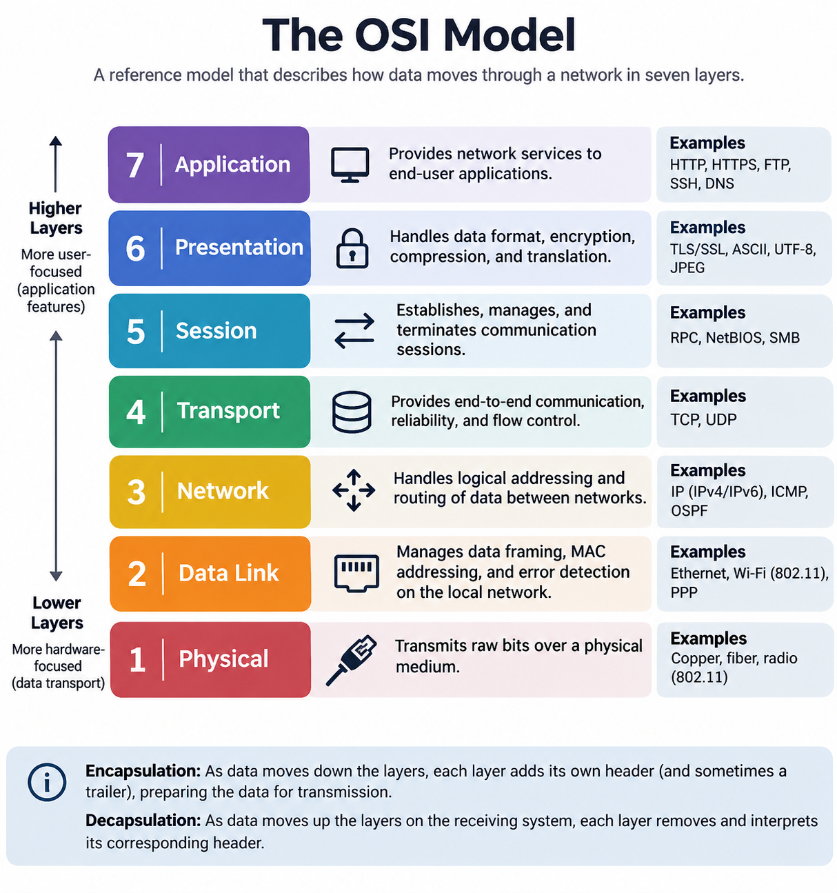

# Prerequisite Knowledge — Exercise 03: Packet Capture & Protocol Analysis

This exercise introduces the concepts behind capturing and interpreting network traffic. Understanding how systems communicate will help you identify normal network behavior and troubleshoot communication failures.

If you are unfamiliar with IP addressing, ports, or firewall filtering, review the [Exercise 01 Prerequisite Knowledge](../01-stateful-firewall-segmentation/prerequisite-knowledge.md) first.

## 1. The OSI Model

The **Open Systems Interconnection (OSI) model** is a conceptual framework that divides network communication into seven layers. Each layer describes a different set of responsibilities involved in transferring data between systems.

| Layer | Name | Primary function | Examples / associated concepts |
|---|---|---|---|
| 7 | Application | Provides network services to applications | HTTP, DNS, SSH |
| 6 | Presentation | Handles data representation, encoding, and transformation | Character encoding, compression, encryption |
| 5 | Session | Establishes, manages, and terminates communication sessions | Session management, synchronization |
| 4 | Transport | Provides end-to-end transport between applications | TCP, UDP, port numbers |
| 3 | Network | Provides logical addressing and routing between networks | IP, ICMP, routers |
| 2 | Data Link | Transfers frames across a local network link | Ethernet frames, MAC addresses, switches |
| 1 | Physical | Transmits bits as signals across a medium | Copper cables, fiber, radio signals |



As data moves down the networking stack, protocols add information, typically in headers. This is called **encapsulation**. The receiving system processes the information in reverse, a process called **decapsulation**.

For example, an HTTP request may be carried within a TCP segment (Layer 4), which is carried within an IP packet (Layer 3), which is carried within an Ethernet frame (Layer 2).

The OSI model is a reference model, not a strict description of how every modern protocol is implemented. In practice, the functions of Layers 5–7 are often combined within application protocols and libraries.

When analyzing packet captures, you will primarily examine Layers 2–4 and, when visible, application-layer information. Identifying the layer at which communication fails can help narrow down the cause of a network issue.

## 2. Packet Capture and Traffic Visibility

Packet capture is the process of collecting network traffic observed at a particular capture point. Tools such as tcpdump and Wireshark allow you to inspect protocol headers and, when available, packet payloads.

A **header** contains information used by a protocol to process or deliver data. A **payload** is the data carried by that protocol.

Where you capture traffic matters. A capture on Ubuntu's network interface can show traffic sent to or from Ubuntu, but it will not necessarily show all traffic exchanged between other systems on the network. Similarly, a capture on the OPNsense WAN interface can show incoming traffic that the firewall subsequently blocks.

Promiscuous mode allows an interface to accept frames not addressed to its own MAC address, but it does not guarantee visibility into all traffic on a switched or virtual network. Traffic must still reach the capture interface.

A **capture filter** restricts which packets are collected. A **display filter** restricts which already-captured packets are displayed. Filtering helps isolate relevant traffic from unrelated network activity.

## 3. TCP Communication

Transmission Control Protocol (TCP) is a connection-oriented transport protocol that provides reliable, ordered delivery of a byte stream. TCP uses sequence numbers, acknowledgments, and retransmissions to support reliable delivery.

Before application data is exchanged, a typical TCP connection is established using the **three-way handshake**:

| Step | Direction | Flags | Purpose |
|---|---|---|---|
| 1 | Client → Server | SYN | Initiates a connection and provides an initial sequence number |
| 2 | Server → Client | SYN, ACK | Acknowledges the client's SYN and provides its own initial sequence number |
| 3 | Client → Server | ACK | Acknowledges the server's SYN |

Once the handshake is complete, application data can be exchanged. TCP flags provide information about the purpose of a segment.

| Flag | Meaning |
|---|---|
| SYN | Synchronizes sequence numbers during connection establishment |
| ACK | Indicates that the acknowledgment field is valid |
| FIN | Indicates that the sender has finished sending data |
| RST | Resets or rejects a connection |
| PSH | Requests prompt delivery of received data to the application |

In tcpdump output, you may see flags represented as `[S]` (SYN), `[S.]` (SYN-ACK), `[.]` (ACK), `[F.]` (FIN-ACK), or `[R.]` (RST-ACK).

A normal connection termination typically involves FIN and ACK exchanges in both directions. A reset terminates a connection abruptly or rejects a connection attempt.

## 4. UDP Communication

User Datagram Protocol (UDP) is a connectionless transport protocol. Unlike TCP, UDP does not establish a connection through a handshake and does not provide built-in acknowledgments, retransmission, or ordered delivery.

| Characteristic | TCP | UDP |
|---|---|---|
| Connection establishment | Three-way handshake | None |
| Built-in reliable delivery | Yes | No |
| Data organization | Byte stream | Individual datagrams |
| Example applications | SSH, traditional HTTP | DNS, DHCP, real-time media |

UDP's simplicity is useful for applications that prioritize low overhead or implement their own reliability mechanisms. A lack of response to a UDP datagram does not necessarily indicate that a firewall blocked it.

## 5. ICMP

Internet Control Message Protocol (ICMP) provides network diagnostic and error-reporting functionality. Unlike TCP and UDP, ICMP does not use transport-layer port numbers.

Common IPv4 ICMP messages include:

| Message | Type / Code | Purpose |
|---|---|---|
| Echo Request | 8 / 0 | Requests a response from another system |
| Echo Reply | 0 / 0 | Responds to an Echo Request |
| Destination Unreachable — Port Unreachable | 3 / 3 | Indicates that the destination transport port is unavailable |
| Time Exceeded — TTL expired | 11 / 0 | Indicates that a packet's time to live expired in transit |

When a UDP datagram reaches a host on a port where no application is listening, the host may return an ICMP Port Unreachable message. Firewall policies and rate limiting can prevent this response from being generated or delivered.

A successful ping demonstrates that ICMP Echo traffic can travel between the systems. It does not establish that a particular TCP or UDP service is accessible.

## 6. HTTP Communication

Hypertext Transfer Protocol (HTTP) is an application-layer protocol used to exchange requests and responses between clients and web servers. In this lab, Apache provides HTTP over TCP port 80.

| HTTP method | Purpose |
|---|---|
| GET | Requests a representation of a resource |
| HEAD | Requests response headers without the response body |
| POST | Submits data for processing by the server |

An example HTTP/1.1 request:

```http
HEAD / HTTP/1.1
Host: 172.16.77.10
```

The first line identifies the request method, resource, and protocol version. The Host header identifies the intended host.

An example response status line:

```http
HTTP/1.1 200 OK
```

| Status code | Meaning |
|---|---|
| 200 | OK — request succeeded |
| 301 | Moved Permanently |
| 403 | Forbidden |
| 404 | Not Found |
| 500 | Internal Server Error |

An HTTP status code is an application-layer response. Receiving a 403 or 404, for example, is different from a TCP connection failing to establish.

## 7. Plaintext and Encrypted Communication

Traditional HTTP does not encrypt application data. Someone with visibility into the traffic may be able to read HTTP headers, request paths, and transmitted content.

HTTPS protects HTTP communication using Transport Layer Security (TLS), providing confidentiality, integrity, and server authentication when certificate validation is performed correctly.

Encryption does not conceal every aspect of network communication. IP addresses, packet sizes, timing, and (for TCP-based HTTPS) transport-layer ports and flags generally remain observable. Application content is not normally readable without access to the appropriate decryption material.

This distinction is important when investigating network traffic: the inability to read application content does not mean the traffic cannot be analyzed.

## 8. Interpreting Network Traffic

Packet captures provide evidence of what was observed at a particular point in the network. The following patterns can help guide troubleshooting:

| Observed traffic | Possible interpretation |
|---|---|
| SYN → SYN-ACK → ACK | TCP connection established |
| Repeated SYNs without a response | Connection attempt is being retried; possible filtering, packet loss, or unreachable destination |
| SYN followed by RST-ACK | Connection refused or actively rejected |
| HTTP request followed by 200 OK | Web server successfully processed the request |
| UDP datagram followed by ICMP Port Unreachable | Destination reports that the UDP port is unavailable |

A **retransmission** occurs when TCP resends data that it believes was not successfully acknowledged. Retransmissions can occur because of packet loss, delayed acknowledgments, or other network conditions. They are not inherently evidence of malicious activity.

In this exercise, you will observe repeated TCP SYN packets on the OPNsense WAN interface when Kali attempts to access Ubuntu through the firewall. Comparing the capture with firewall logs helps establish why the connection failed. A capture alone may not reveal where a packet was dropped or why a response was absent.

When analyzing traffic, consider the source and destination addresses, ports, protocol, direction, flags, and sequence of events. Correlate these observations with other available evidence before drawing a conclusion.

---

Return to the [Exercise 03 README](README.md) or continue to the [walkthrough](03-walkthrough.md).
