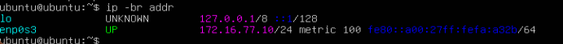
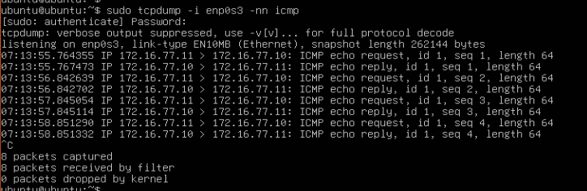
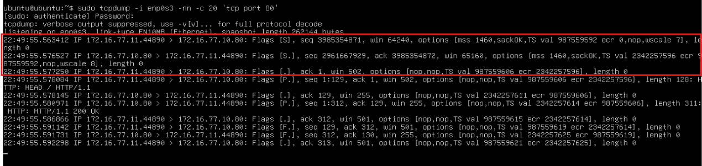
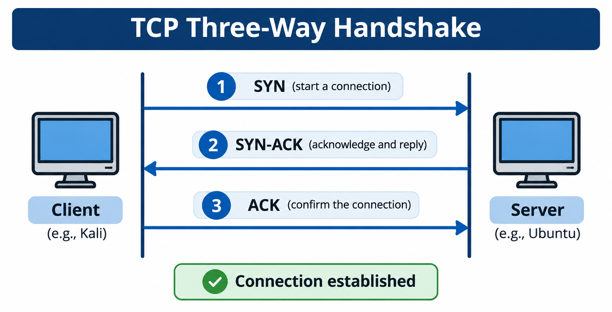
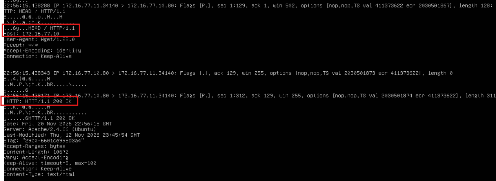
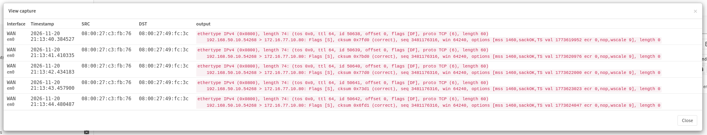
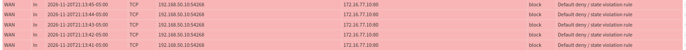
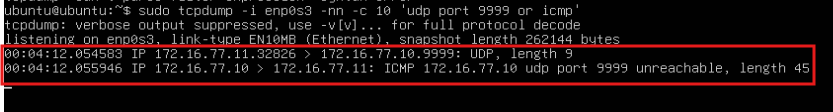

# Exercise 3 — Packet Capture & Protocol Analysis

**Difficulty:** Beginner  
**Focus:** ICMP, TCP, UDP, HTTP, packet capture, and firewall traffic analysis  
**Platform:** Ubuntu Server, Debian, Kali Linux, OPNsense 26.7, VirtualBox

## Overview

Capture and interpret network traffic between lab hosts, then compare packets arriving at OPNsense with its firewall decisions. This walkthrough documents the commands, observed results, and evidence from a completed exercise.

**Lab addresses:** Ubuntu `172.16.77.10`, Debian `172.16.77.11`, Kali `192.168.50.10`, OPNsense WAN `192.168.50.1`, OPNsense LAN `172.16.77.1`.

**Prerequisites:** Complete the [Lab Environment Setup](../../Lab%20Environment%20Setup.md). Confirm `tcpdump` is installed on Ubuntu, Wireshark is available on Kali, Apache is running on Ubuntu, and the temporary HTTP allow rule from Exercise 1 has been removed. Keep all VMs on their isolated VirtualBox Internal Networks.

## Task 1 — Prepare Capture Tools

On **Ubuntu**, check the capture tool and identify the network interface:

```bash
command -v tcpdump
ip -br addr
```

On **Kali**, check for Wireshark:

```bash
command -v wireshark
```

**Command notes:** `command -v` locates an installed executable. `ip -br addr` displays a compact list of interfaces and addresses (`-br` = brief).

**Verify:** Ubuntu has `tcpdump` and its internal interface is `enp0s3` (`172.16.77.10/24`); Wireshark is available on Kali.



## Task 2 — Capture ICMP Traffic

On **Ubuntu**, start the capture:

```bash
sudo tcpdump -i enp0s3 -nn icmp
```

**Command notes:** `tcpdump` displays captured packets; `-i` selects an interface, `-nn` disables address/port name resolution, and `icmp` filters for IPv4 ICMP traffic.

On **Debian**, send four ping requests:

```bash
ping -c 4 172.16.77.10
```

Return to Ubuntu and press **Ctrl+C** to stop capturing.

**Read the output:** `>` separates the source and destination. `echo request` is Debian's ping; `echo reply` is Ubuntu's response. Matching `seq` values identify the corresponding request and reply.

**Observed:** ICMP Echo Requests from `172.16.77.11` and Echo Replies from `172.16.77.10`.



## Task 3 — Analyze the TCP Three-Way Handshake

On **Ubuntu**, start a TCP port 80 capture:

```bash
sudo tcpdump -i enp0s3 -nn -c 20 'tcp port 80'
```

**New option:** `-c 20` ends the capture after 20 packets; `'tcp port 80'` limits results to TCP packets using port 80.

On **Debian**, request the HTTP headers:

```bash
wget --spider -S http://172.16.77.10
```

**Command notes:** `--spider` checks the resource without downloading the page; `-S` prints response headers. Stop tcpdump with **Ctrl+C** if it has not reached 20 packets.

**Read the output:** The first three TCP packets establish the connection:

| Sequence | tcpdump flag | Meaning |
|---|---|---|
| 1 | `[S]` | Debian sends SYN |
| 2 | `[S.]` | Ubuntu responds with SYN-ACK |
| 3 | `[.]` | Debian sends ACK |

The source port (for example, `44890`) is an ephemeral client port; Ubuntu's destination port `80` identifies HTTP. Later packets show the HTTP exchange and connection termination.

**Observed:** SYN → SYN-ACK → ACK, followed by `HEAD / HTTP/1.1`, `HTTP/1.1 200 OK`, and TCP connection closing packets.



**TCP three-way handshake — learning reference**



## Task 4 — Inspect HTTP Traffic

On **Ubuntu**, capture readable HTTP payloads:

```bash
sudo tcpdump -i enp0s3 -nn -A -c 20 'tcp port 80'
```

**New option:** `-A` displays packet contents as ASCII text.

On **Debian**, generate an HTTP request:

```bash
wget --spider -S http://172.16.77.10
```

**Read the output:** `HEAD / HTTP/1.1` is the request; `Host: 172.16.77.10` identifies the requested host; `HTTP/1.1 200 OK` is the successful server response. Other characters are packet data not rendered as readable text.

**Observed:** The request and response headers were visible in plaintext. Press **Ctrl+C** to stop any remaining capture.



## Task 5 — Investigate Blocked Traffic

**Objective:** Show that Kali's connection attempt reaches OPNsense WAN but is blocked before reaching Ubuntu.

### 5.1 — Confirm Kali's test route

On **Kali**:

```bash
ip route get 172.16.77.10
```

Confirm the route goes **via `192.168.50.1 dev eth0`**, with source `192.168.50.10`.

**OPNsense management access:** If Kali cannot open `https://172.16.77.1`, temporarily enable Kali Adapter 2 on the VirtualBox Internal Network `PFSense Network`, obtain its LAN address, and run:

```bash
sudo ip route replace 172.16.77.1/32 dev eth1
```

This directs management traffic to OPNsense's LAN address. **Before testing**, recheck `ip route get 172.16.77.10`: it must still use **`eth0` via the WAN**. If it uses `eth1`, stop—the test would bypass the WAN firewall. Disable the temporary adapter during cleanup.

### 5.2 — Capture inbound WAN traffic

In OPNsense, open **Interfaces → Diagnostics → Packet Capture** and set:

| Field | Value |
|---|---|
| Interface | `em0 [WAN]` |
| Promiscuous | Unchecked |
| Address Family | Any |
| Protocol | TCP |
| Host Address | `192.168.50.10` |
| Port | `80` |
| Count | `20` |

Click **Start**. On Kali, generate the blocked connection attempt:

```bash
wget --spider -S -T 5 -t 1 http://172.16.77.10
```

**Options:** `-T 5` sets a five-second timeout; `-t 1` limits attempts to one at the wget level. The TCP stack may still retransmit SYN packets.

**Observed:** The HTTP request timed out.

Return to OPNsense, stop the capture, then open **Jobs → View Capture (High Detail)**.

**Read the output:** `Flags [S]` identifies a TCP SYN. Repeated packets with the same source port and sequence number indicate retransmission.

**Observed:** Five WAN SYN packets from `192.168.50.10:54268` to `172.16.77.10:80`, without a response shown in the capture.



### 5.3 — Confirm the firewall decision

Open **Firewall → Log Files → Live View** and filter for source `192.168.50.10` and destination `172.16.77.10`.

**Observed:** WAN / In / TCP / `block` entries for `192.168.50.10:54268 → 172.16.77.10:80`, labeled `Default deny / state violation rule`.



**Interpretation:** The packet capture shows SYN packets *arriving* at the WAN interface. The firewall log independently confirms the *block decision*. The matching source port links both records to the same connection attempt.

## Task 6 — Compare UDP and ICMP Behavior

On **Ubuntu**, capture UDP traffic to port 9999 and any ICMP response:

```bash
sudo tcpdump -i enp0s3 -nn -c 10 'udp port 9999 or icmp'
```

**Filter note:** `or` includes packets matching either expression. Keep the entire filter inside matching quotation marks.

On **Debian**, send a UDP datagram:

```bash
echo "UDP test" | nc -u -w 2 172.16.77.10 9999
```

**Command notes:** `echo` prints text; `|` sends that text to the next command; `nc -u` uses UDP; `-w 2` sets a two-second timeout.

**Observed:** A UDP datagram from `172.16.77.11:32826` to `172.16.77.10:9999`, followed by an ICMP `udp port 9999 unreachable` response from Ubuntu. This indicates no service was listening on that UDP port.

Unlike TCP, UDP does not establish a three-way handshake. Stop tcpdump with **Ctrl+C** if fewer than ten packets appear.



## Task 7 — Cleanup & Final Validation

1. Stop any running `tcpdump` sessions with **Ctrl+C**.
2. Stop or close the OPNsense packet capture job.
3. Shut down Kali and disable its temporary Adapter 2 (`PFSense Network`), if enabled for management.
4. Confirm the original OPNsense WAN rules remain unchanged; no exercise-specific allow rule was created.

No additional screenshot is required for cleanup. The lab should remain isolated and ready for Exercise 4.
