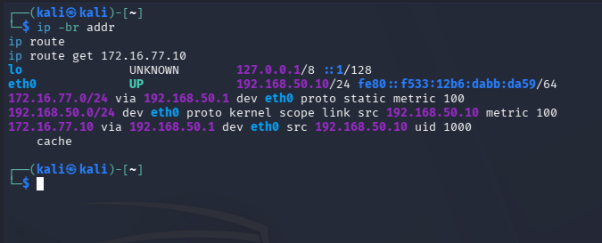
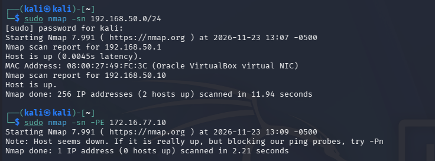
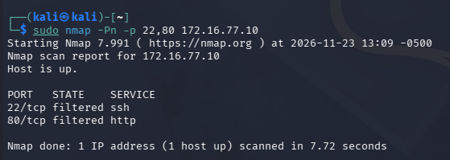
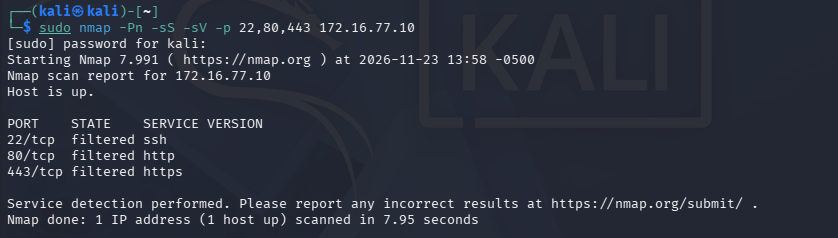
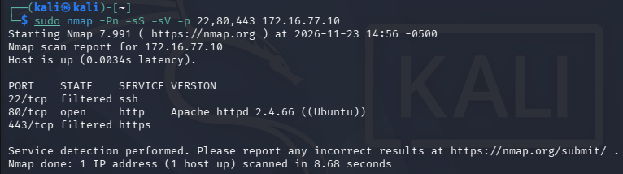
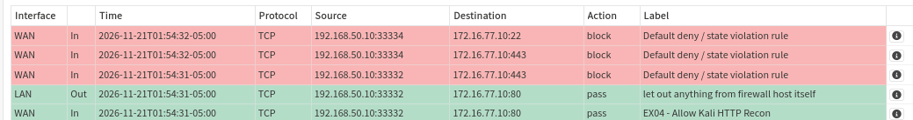
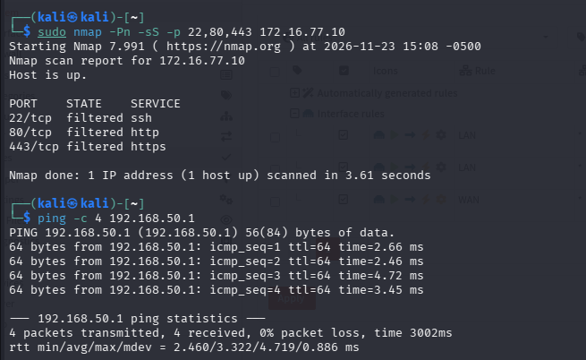

# Exercise 4 — Network Reconnaissance & Firewall Testing

**Difficulty:** Beginner–Intermediate  
**Platform:** Kali Linux, Debian, Ubuntu Server, OPNsense 26.7, VirtualBox  
**Focus:** Host discovery, service enumeration, firewall filtering, and scan validation

This walkthrough documents the observed results from the four-VM isolated lab. Complete the [Lab Environment Setup](../../Lab%20Environment%20Setup.md) before starting. Keep all VM adapters on their designated VirtualBox Internal Networks; do not bridge the lab to a physical network.

| System | Address | Role |
|---|---|---|
| Kali | `192.168.50.10/24` | External scanning host (`Lab-External`) |
| OPNsense WAN | `192.168.50.1/24` | External firewall interface |
| OPNsense LAN | `172.16.77.1/24` | Internal firewall interface |
| Ubuntu | `172.16.77.10/24` | Protected SSH/Apache server |
| Debian | `172.16.77.11/24` | Internal scanning host |

> **Management access:** OPNsense's web interface is on `https://172.16.77.1`. When needed, shut down Kali and temporarily enable Adapter 2 on VirtualBox Internal Network `PFSense Network`. After starting Kali, direct management traffic with `sudo ip route replace 172.16.77.1/32 dev eth1`. **Before each external scan**, confirm `ip route get 172.16.77.10` uses `eth0` via `192.168.50.1`, not `eth1`. Disable Adapter 2 after administration. See Exercise 1 for the full procedure.

## Task 1 — Establish the Network Baseline

On **Kali**, inspect its interface addresses and routes:

```bash
ip -br addr
ip route
ip route get 172.16.77.10
```

`ip -br addr` shows a brief interface/address summary; `ip route` lists routes; `ip route get` shows the selected path to one destination.

**Observed:** `eth0` had `192.168.50.10/24`, and traffic to Ubuntu used `192.168.50.1` via `eth0`. Kali's temporary `eth1` management adapter was initially enabled, so it was disabled before proceeding. The corrected routing table no longer contained the unwanted default route through the internal network.

Confirm the existing ICMP exception to the OPNsense WAN:

```bash
ping -c 4 192.168.50.1
```

`-c 4` sends four Echo Requests. **Observed:** OPNsense responded successfully.



## Task 2 — Perform Host Discovery

From **Kali**, discover hosts on the directly connected external subnet:

```bash
sudo nmap -sn 192.168.50.0/24
```

`-sn` performs host discovery without a port scan. **Observed:** Nmap identified two hosts: OPNsense (`192.168.50.1`) and Kali (`192.168.50.10`).



Try discovering Ubuntu across the firewall, then scan selected ports without host discovery:

```bash
sudo nmap -sn -PE 172.16.77.10
sudo nmap -Pn -p 22,80 172.16.77.10
```

`-PE` requests ICMP Echo discovery; `-Pn` skips discovery and treats the target as online for scanning; `-p` specifies ports. **Observed:** Discovery reported zero hosts, while the forced scan reported TCP 22 and 80 as `filtered`.

**Reading the output:** `Host seems down` means discovery probes did not establish that the host was reachable. With `-Pn`, `Host is up` is an assumption made for scanning—not proof of a reply. `filtered` means Nmap could not determine whether a port was open or closed.



## Task 3 — Enumerate Internal Services

From **Debian**, scan Ubuntu's selected TCP ports and probe open services for version information:

```bash
nmap -sT -sV -p 22,80,443 172.16.77.10
```

`-sT` uses a TCP connect scan; `-sV` attempts service/version detection. **Observed:**

| Port | State | Service detected |
|---|---|---|
| 22/tcp | `open` | OpenSSH 10.2p1 (Ubuntu) |
| 80/tcp | `open` | Apache httpd 2.4.66 (Ubuntu) |
| 443/tcp | `closed` | No HTTPS listener |

**Reading the output:** `open` indicates an accepting service; `closed` indicates the host responded but no service accepted the connection. The `VERSION` column reflects Nmap's probe-based identification and may not always be exact.


> **Observed troubleshooting note:** An earlier Debian scan unexpectedly reported all three ports as `filtered`. Debian-to-Ubuntu ICMP connectivity and Ubuntu's SSH/Apache listeners were verified. Direct Netcat tests subsequently succeeded on TCP 22 and 80 and received `Connection refused` on TCP 443; the repeated Nmap scan then returned the results above. The cause of the earlier discrepancy was not established. No network or firewall change was made to resolve it.

## Task 4 — Test External Reconnaissance

From **Kali**, repeat the targeted scan across OPNsense:

```bash
sudo nmap -Pn -sS -sV -p 22,80,443 172.16.77.10
```

`-sS` uses a TCP SYN scan (introduced in earlier exercises). **Observed:** TCP 22, 80, and 443 were all `filtered`; no service versions were identified.

| Port | Debian (internal) | Kali (external) |
|---|---|---|
| 22/tcp | Open | Filtered |
| 80/tcp | Open | Filtered |
| 443/tcp | Closed | Filtered |



## Task 5 — Validate a Temporary Firewall Exception

In **OPNsense → Firewall → Rules → WAN**, add a temporary rule with these values:

| Setting | Value |
|---|---|
| Action / Direction | Pass / In |
| Interface | WAN |
| IP version / Protocol | IPv4 / TCP |
| Source | `192.168.50.10/32` |
| Destination | `172.16.77.10/32` |
| Destination port | `80` (HTTP) |
| State type | Keep state |
| Log | Enabled |
| Description | `EX04 - Allow Kali HTTP Recon` |

**Save and click Apply Changes.** Keep the existing Kali-to-OPNsense WAN ICMP rule intact. Verify Kali's route to Ubuntu still uses `eth0` before testing.

On **Kali**, repeat:

```bash
sudo nmap -Pn -sS -sV -p 22,80,443 172.16.77.10
```

**Observed:** TCP 80 changed from `filtered` to `open`, and Nmap identified Apache httpd 2.4.66. TCP 22 and 443 remained `filtered`.



## Task 6 — Analyze Scan Results and Firewall Logs

Open **OPNsense → Firewall → Log Files → Live View**. Filter for Kali (`192.168.50.10`) communicating with Ubuntu (`172.16.77.10`). Generate fresh traffic from Kali:

```bash
sudo nmap -Pn -sS -p 22,80,443 172.16.77.10
```

**Observed WAN inbound log decisions:**

| Destination | Action | Label |
|---|---|---|
| TCP 22 | Block | `Default deny / state violation rule` |
| TCP 80 | Pass | `EX04 - Allow Kali HTTP Recon` |
| TCP 443 | Block | `Default deny / state violation rule` |

A separate **LAN Out / Pass** row for HTTP was also present. Use the **WAN In / Pass** entry to identify the rule that allowed the incoming scan. If that pass entry is missing, verify that rule logging is enabled and changes were applied.



## Task 7 — Restore and Verify the Baseline

In **OPNsense → Firewall → Rules → WAN**, delete only `EX04 - Allow Kali HTTP Recon`, then **Apply Changes**. Preserve the original Kali-to-OPNsense WAN ICMP exception.

On **Kali**, verify the restored restrictions and original ICMP access:

```bash
sudo nmap -Pn -sS -p 22,80,443 172.16.77.10
ping -c 4 192.168.50.1
```

**Observed:** TCP 22, 80, and 443 returned to `filtered`. The WAN ping received four replies with 0% packet loss. This confirms that the temporary HTTP access no longer works and the original ICMP exception still functions.



**Final cleanup:** If Kali Adapter 2 was enabled for OPNsense administration, shut down Kali and disable it. No other lab changes are required.

[04-walkthrough.md](https://github.com/user-attachments/files/35297500/04-walkthrough.md)
