# Exercise 6 — SSH Brute-Force Detection & Response

This walkthrough demonstrates SSH authentication log analysis, automated detection of repeated authentication failures, source IP containment, and recovery using Fail2ban.

Complete the [Lab Environment Setup](../../Lab%20Environment%20Setup.md) before beginning. Fail2ban must be installed on Ubuntu (`sudo apt install fail2ban` during initial setup while internet access is available). Keep the lab isolated during testing and administer Ubuntu through its VirtualBox console. Confirm Fail2ban is stopped and UFW is inactive before beginning.

## Task 1 — Establish Authentication Baseline

On Ubuntu, run:

```bash
sudo systemctl status ssh.socket --no-pager
command -v fail2ban-client
sudo sshd -T | grep -E '^(passwordauthentication|pubkeyauthentication|permitrootlogin|maxauthtries|maxstartups) '
```

- `command -v` — Identifies the executable available in the shell's search path.
- `sshd -T` — Displays the effective SSH daemon configuration.
- `grep -E` — Filters output using an extended regular expression.

Verify that SSH is listening, Fail2ban is installed, and password authentication is enabled.

| SSH setting | Observed value | Meaning |
|---|---|---|
| `passwordauthentication` | yes | Password authentication permitted |
| `pubkeyauthentication` | yes | Public-key authentication permitted |
| `permitrootlogin` | prohibit-password | Root password authentication prohibited |
| `maxauthtries` | 6 | Maximum authentication attempts per connection |
| `maxstartups` | 10:30:100 | Probabilistic rejection of unauthenticated connections begins at 10, with 30% initial rejection, reaching 100% at 100 |

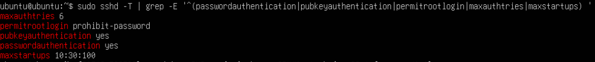

On Debian, verify SSH connectivity:

```bash
nc -z -v -w 3 172.16.77.10 22
```


## Task 2 — Simulate Failed Authentication

On Debian, initiate an SSH connection:

```bash
ssh ubuntu@172.16.77.10
```

If prompted to trust the server's host key, compare its fingerprint with the corresponding public host key on Ubuntu before accepting it. For an ED25519 key, run on Ubuntu:

```bash
ssh-keygen -lf /etc/ssh/ssh_host_ed25519_key.pub
```

- `-l` — Displays the key fingerprint.
- `-f` — Specifies the key file.

Enter an intentionally incorrect password three times. The server rejects the credentials and the client terminates the connection after its password prompts are exhausted.

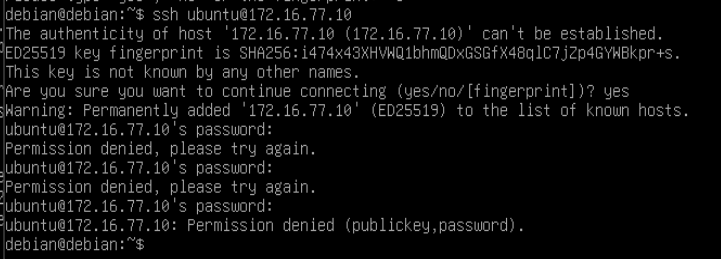

## Task 3 — Investigate Authentication Logs

On Ubuntu, retrieve and filter SSH service logs:

```bash
sudo journalctl -u ssh.service --since "10 minutes ago" --no-pager
sudo journalctl -u ssh.service --since "10 minutes ago" --no-pager | grep 'Failed password'
```

- `journalctl -u` — Retrieves journal entries associated with a systemd unit.
- `--since` — Restricts results to the specified time window.
- `--no-pager` — Displays output directly in the terminal.

Extend the time window if necessary. Three failed password events identify the target account `ubuntu`, source IP `172.16.77.11`, source port `55428`, and SSH protocol. The shared source port and process ID are consistent with repeated authentication attempts within one connection.

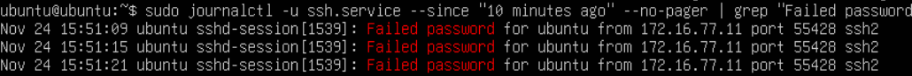

## Task 4 — Configure Automated Protection

On Ubuntu, create a dedicated configuration file:

```bash
sudo nano /etc/fail2ban/jail.d/exercise6.local
```

```ini
[sshd]
enabled = true
port = ssh
filter = sshd
backend = systemd
maxretry = 3
findtime = 60
bantime = 300
```

A jail combines log monitoring, detection criteria, and response actions.

| Parameter | Purpose |
|---|---|
| `enabled` | Activates the jail |
| `port` | Identifies the protected service (SSH, TCP 22) |
| `filter` | Selects SSH authentication failure patterns |
| `backend` | Reads events from the systemd journal |
| `maxretry` | Triggers a ban at three matching failures |
| `findtime` | Evaluates failures within 60 seconds |
| `bantime` | Maintains the ban for 300 seconds |

These thresholds are selected for lab testing, not as universal production recommendations.

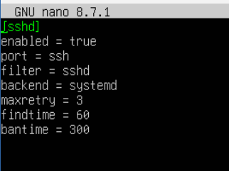

Validate the configuration and restart the service:

```bash
sudo fail2ban-client -t
sudo systemctl restart fail2ban
```

- `-t` — Tests the Fail2ban configuration.
- `restart` — Restarts the service and loads the saved configuration, even if it was already running.

Verify the active settings:

```bash
sudo fail2ban-client get sshd maxretry
sudo fail2ban-client get sshd findtime
sudo fail2ban-client get sshd bantime
```

The values must be `3`, `60`, and `300` respectively. During initial testing, the running service retained default values of `5`, `600`, and `600`; restarting it resolved the discrepancy.

```bash
sudo fail2ban-client status
sudo fail2ban-client status sshd
```

Confirm the SSH jail is active and Debian is not banned. Historical failure counters may be nonzero. The initial status below was captured before the corrected restart; use the active parameter checks above to verify the intended policy.

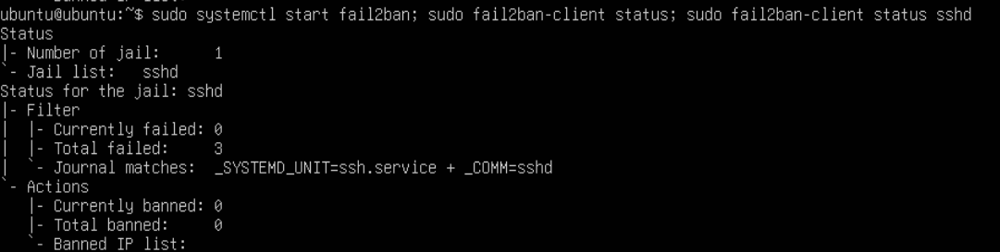

## Task 5 — Validate Detection and Response

On Ubuntu, monitor Fail2ban events:

```bash
sudo tail -f /var/log/fail2ban.log
```

- `tail -f` — Displays the end of a log file and follows newly appended entries.

On Debian, run:

```bash
ssh ubuntu@172.16.77.10
```

Enter three incorrect passwords within 60 seconds. Ubuntu should display three `Found` events followed by a `Ban` event for `172.16.77.11`. In the observed test, the three failures occurred within approximately 13 seconds and triggered a ban.

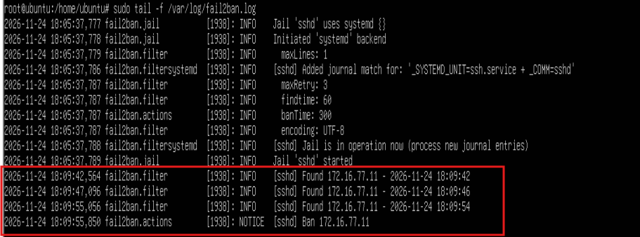

Press Ctrl+C on Ubuntu and verify the active ban:

```bash
sudo fail2ban-client status sshd
```

Confirm that Debian's IP appears in the banned IP list.

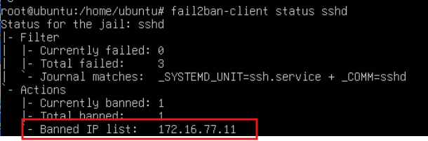

Immediately test connectivity from Debian:

```bash
nc -z -v -w 3 172.16.77.10 22
nc -z -v -w 3 172.16.77.10 80
```

SSH should fail while HTTP succeeds. The port-specific response preserves unrelated service accessibility. Complete testing within the five-minute ban window; if the ban expires, repeat the failed authentication attempts.

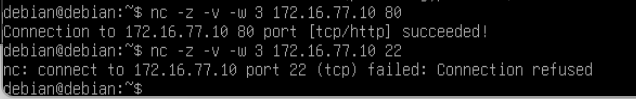

## Task 6 — Investigate and Recover

On Ubuntu, review the ban history and inspect firewall enforcement:

```bash
sudo grep -E '\[sshd\].*(Ban|Unban)' /var/log/fail2ban.log
sudo nft list ruleset
```

- `nft list ruleset` — Displays the active nftables firewall configuration.

If the ban has expired, repeat the failed authentication attempts before inspecting the ruleset.

Identify `f2b-table`, `f2b-chain`, and `addr-set-sshd`. The address set should contain `172.16.77.11` during an active ban. The observed rule matches TCP destination port 22 and source addresses in that set, rejecting matching traffic with an ICMP port-unreachable response.

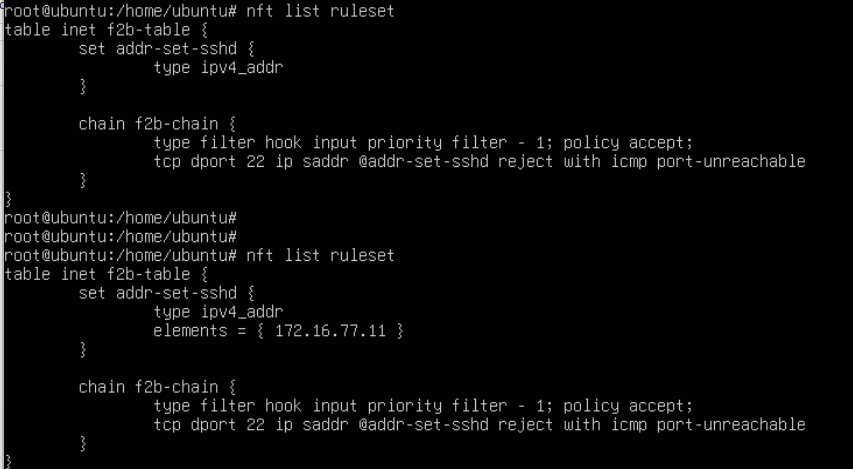

Manually remove the ban:

```bash
sudo fail2ban-client set sshd unbanip 172.16.77.11
sudo fail2ban-client status sshd
sudo nft list ruleset
```

- `unbanip` — Removes the specified IP from the jail's ban list.

A return value of `1` indicates one ban was removed; `0` indicates no matching active ban remained. The observed screenshot was captured after the initial manual unban, so the repeated command returned `0`. The empty ban list and empty nftables address set confirm the post-unban state. The SSH protection rule remains available for future bans.

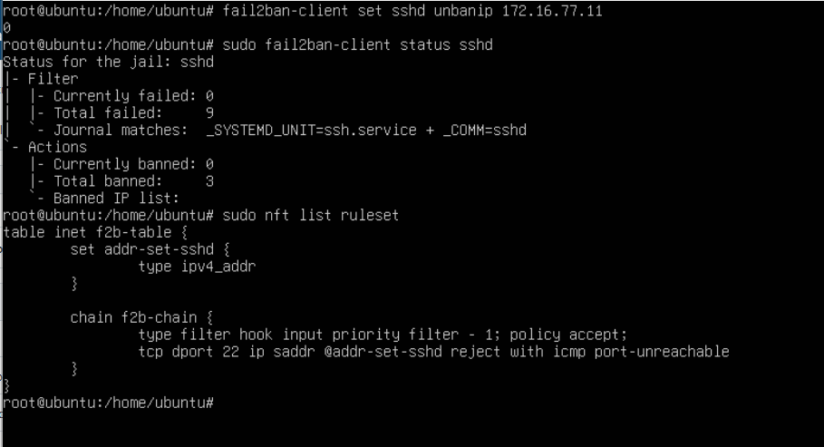

On Debian, establish a legitimate SSH session using the correct password:

```bash
ssh ubuntu@172.16.77.10
```

After authentication, run on the remote Ubuntu system:

```bash
whoami
hostname
```

Confirm the expected account and hostname (`ubuntu`).

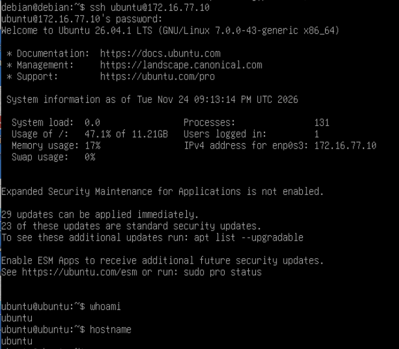

Run `exit` to terminate the session.

## Task 7 — Restore Baseline

On Ubuntu, stop and disable Fail2ban and remove only the exercise-specific configuration:

```bash
sudo systemctl disable --now fail2ban
sudo rm /etc/fail2ban/jail.d/exercise6.local
```

- `disable --now` — Stops the service and prevents automatic startup.

Verify cleanup:

```bash
sudo systemctl is-active fail2ban
sudo systemctl is-enabled fail2ban
sudo nft list ruleset
sudo ufw status
```

Confirm Fail2ban is inactive and disabled, its firewall table is removed, and UFW remains inactive. Preserve unrelated firewall rules.

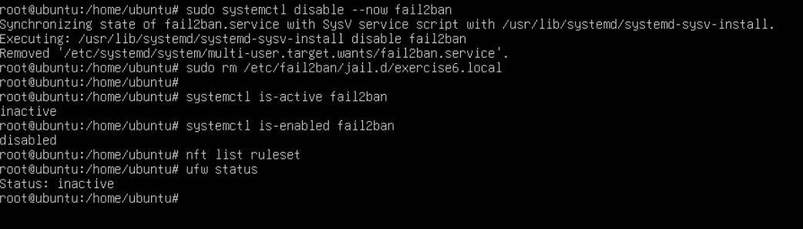

On Debian, verify both services are accessible:

```bash
nc -z -v -w 3 172.16.77.10 22
nc -z -v -w 3 172.16.77.10 80
```

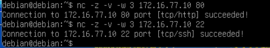

Leave Fail2ban installed and preserve the logs. No OPNsense changes are required.
